# Driving Views

This index lists every SysML v2 `view` declared in the `.sysml` files of
this first-level model area. Each entry explains the reviewer question in
plain language and embeds the committed diagram SysIDE renders from the
view (`syside viz view`, run by the Privileged Syside Validation workflow).
The SVGs live in [`diagrams/`](diagrams/) beside the model files.

Generated by `scripts/generate_view_index.py` — do not edit by hand.

**11 files, 26 views, 24 published diagrams.**

## `closed_loop_driving_capability_classification.sysml`

### `closedLoopDrivingClassificationView`

Product-line engineers and systems engineers need the driving stack identified as the feature candidate that distinguishes the driving member, with what it requires of the sensing and the deferred scope it turns into variability.

- **Source:** `closed_loop_driving_capability_classification.sysml`
- **Viewpoint:** `selectedProductLineClassificationViewpoint` (`ProductLineClassificationViewpoint`)
- **View type:** `TVD::TableView`
- **Concern:** `closedLoopDrivingClassificationConcern`
- **Exposes:** `autoE2EDrivingStack`

- **Diagram status:** Published from the committed SysIDE SVG.

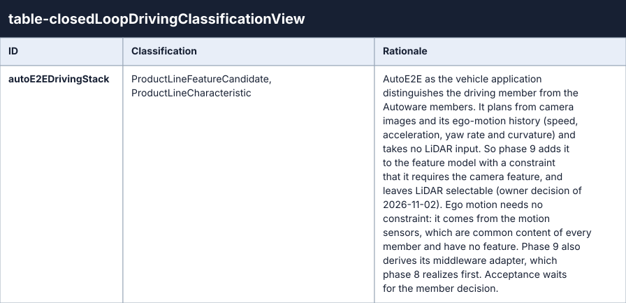

## `closed_loop_driving_framing.sysml`

### `closedLoopDrivingFramingView`

Shows the model elements selected to address the closed loop driving boundary concern.

- **Source:** `closed_loop_driving_framing.sysml`
- **Viewpoint:** `closedLoopDrivingFramingViewpoint` (`IncrementFramingViewpoint`)
- **Concern:** `closedLoopDrivingBoundary`
- **Exposes:** `ClosedLoopDrivingIncrement`, `closedLoopDrivingIncrement`, `closedLoopDrivingProblem`, `closedLoopDrivingQuestion`, `closedLoopDrivingDecision`, `closedLoopDrivingBaselineDecision`, `candidateDrivingSystem`, `closedLoopDrivingScope`, `closedLoopDrivingBoundary`, `drivenAlongTheRouteConcern`, `checkpointCommandAuthorityConcern`, `scoreCommandPathConcern`, `aaosObservationFidelityConcern`, `degradedInputBehaviorConcern`, `timeDomainHonestyConcern`, `reproducibleClosedLoopEvidenceConcern`, `learnedDrivingInScope`, `integrationAndObservationInScope`, `feedbackAndTimingInScope`, `closedLoopEvidenceInScope`, `roadDeploymentOutOfScope`, `existingAEBSBehaviorOutOfScope`, `modelTrainingOutOfScope`, `closedLoopDrivingCharter`, `closedLoopVerificationEnvironment`, `asmEngineeringUse`, `asmSourceAuthenticity`, `asmCandidateReuse`, `gapClosedLoopPerformance`, `gapModelInputAndFeedback`, `gapTransportAndControl`, `gapProductLineAdmission`, `gapAdoptionAndRights`, `gapBoundedCloudCampaign`
- **Render:** `asTreeDiagram`

- **Diagram status:** Published from the committed SysIDE SVG.
- **Presentation note:** This is a dense review artifact; open the SVG at full size rather than reading it from the page thumbnail.

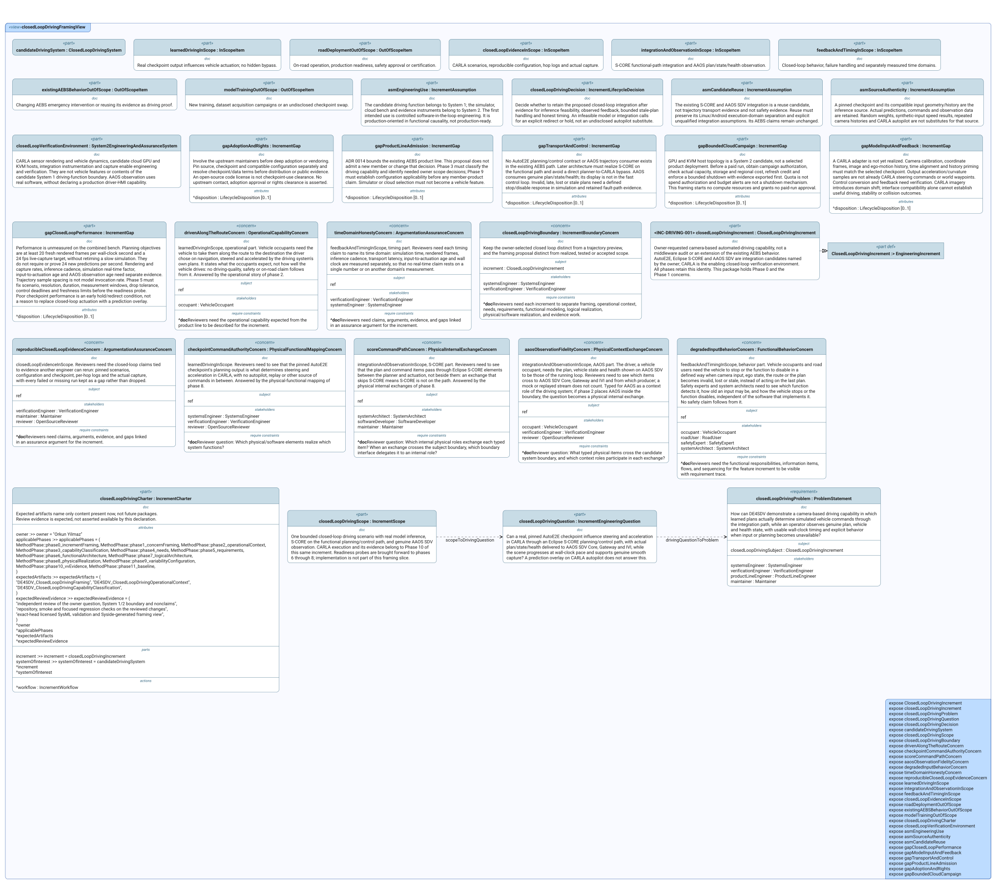

## `closed_loop_driving_functional_architecture.sysml`

### `closedLoopDrivingFunctionBreakdownView`

System architects and verification engineers need the functions of the driving system and each requirement of phase 5 mapped to the functions that carry it: phase 7 gives the functions to logical elements, and phase 10 verifies each requirement on its functions.

- **Source:** `closed_loop_driving_functional_architecture.sysml`
- **Viewpoint:** `selectedFunctionalBreakdownViewpoint` (`SystemFunctionalBreakdownStructureViewpoint`)
- **Concern:** `closedLoopDrivingFunctionsConcern`
- **Exposes:** `closedLoopDrivingFunctionalFlow`
- **Render:** `asTreeDiagram`

- **Diagram status:** Published from the committed SysIDE SVG.
- **Presentation note:** SysIDE lists the items and the seven functions of `closedLoopDrivingFunctionalFlow` but does not draw the flows between them. The flows are modeled in the source, in the action definition `ClosedLoopDrivingFunctionalFlow`, and the requirements each function carries are in `closedLoopDrivingRequirementFunctionMappingView`.

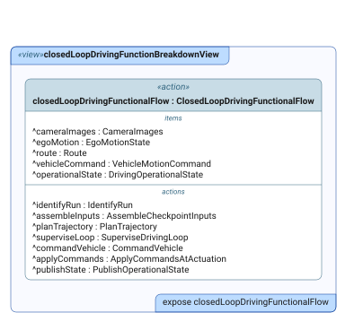

### `closedLoopDrivingRequirementFunctionMappingView`

System architects and verification engineers need the functions of the driving system and each requirement of phase 5 mapped to the functions that carry it: phase 7 gives the functions to logical elements, and phase 10 verifies each requirement on its functions.

- **Source:** `closed_loop_driving_functional_architecture.sysml`
- **Viewpoint:** `selectedRequirementFunctionViewpoint` (`SystemRequirementTraceabilityViewpoint`)
- **View type:** `MVD::MatrixView`
- **Concern:** `closedLoopDrivingFunctionsConcern`
- **Exposes:** `reqPlanEachStep`, `reqPlansByCheckpointInference`, `reqCameraImagesInCheckpointForm`, `reqCameraHistory`, `reqProjectionOperators`, `reqMapContextRaster`, `reqRouteMaskRaster`, `reqEgoMotionHistory`, `reqHoldUntilHistoriesComplete`, `reqHistoriesFromCapturedInputs`, `reqCommandsFromNewestValidPlan`, `reqCommandsWithinActuationLimits`, `reqPlanWithinPlanningPeriod`, `reqPlansAndCommandsOverSCORE`, `reqPublishPlans`, `reqPublishVehicleState`, `reqPublishHealthPeriodically`, `reqPlansIndependentOfObservation`, `reqPlanningTimeIndependentOfObservation`, `reqStopResponseDeceleration`, `reqStopResponseSteeringHeld`, `reqStandstillAfterStop`, `reqStopOnDegradedCameraImages`, `reqStopOnDegradedMotion`, `reqStopOnDegradedRoute`, `reqStopOnStalePlan`, `reqStopOnInvalidPlan`, `reqStopOnLostCommands`, `reqPublishStop`, `reqStampInputs`, `reqStampPlans`, `reqStampCommands`, `reqRecordRunIdentity`, `reqPlansNameRunRecord`, `reqRefuseUnpinnedCheckpoint`, `closedLoopDrivingFunctionalFlow::identifyRun`, `closedLoopDrivingFunctionalFlow::assembleInputs`, `closedLoopDrivingFunctionalFlow::planTrajectory`, `closedLoopDrivingFunctionalFlow::superviseLoop`, `closedLoopDrivingFunctionalFlow::commandVehicle`, `closedLoopDrivingFunctionalFlow::applyCommands`, `closedLoopDrivingFunctionalFlow::publishState`, `DE4SDV_ClosedLoopDrivingFunctionalArchitecture::*`

- **Diagram status:** Published from the committed SysIDE SVG.

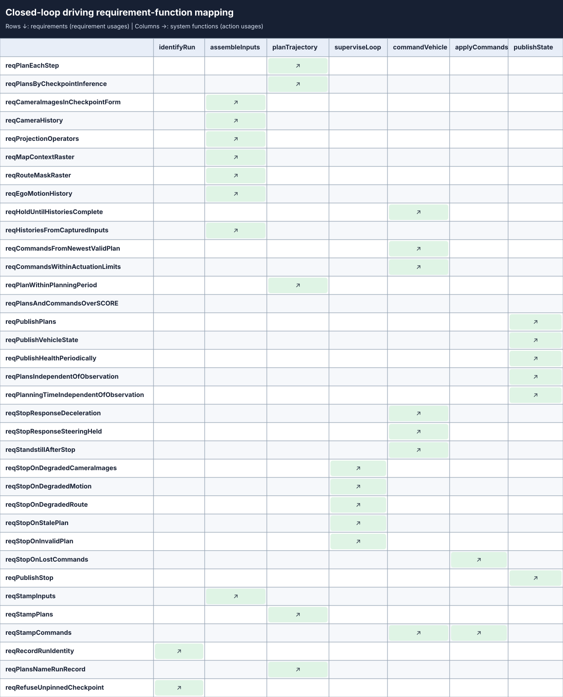

### `closedLoopDrivingSystemProcessView`

System architects and systems engineers need the loop as a process: the functions navigation, the vehicle's cameras and motion sensing, its actuation and the state observer perform, which of those functions are outside the scope of the driving system, what the driving system provides and what it expects from each context element, and which items cross its boundary in which direction.

- **Source:** `closed_loop_driving_functional_architecture.sysml`
- **Viewpoint:** `selectedSystemProcessViewpoint` (`SystemProcessViewpoint`)
- **View type:** `ActionFlowView`
- **Concern:** `closedLoopDrivingProcessConcern`
- **Exposes:** `ClosedLoopDrivingSystemProcess::*`, `ClosedLoopDrivingSystemProcess::navigation::*`, `ClosedLoopDrivingSystemProcess::vehicle::*`, `ClosedLoopDrivingSystemProcess::drivingSystem::*`, `ClosedLoopDrivingSystemProcess::stateObserver::*`

- **Diagram status:** Published from the committed SysIDE SVG.

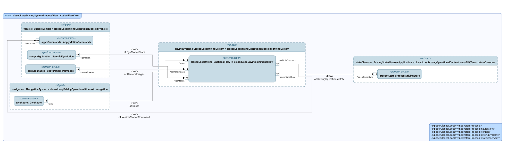

### `closedLoopDrivingModeDependenceTableView`

System architects and software developers need the modes of the driving system and each function whose behavior differs by mode: what CommandVehicle commands while priming, while driving and while stopped, and what PublishOperationalState publishes of the stop and its cause, so that the behavior of each function is designed and built per mode.

- **Source:** `closed_loop_driving_functional_architecture.sysml`
- **Viewpoint:** `selectedSystemStateTableViewpoint` (`SystemStateViewpoint`)
- **View type:** `TVD::TableView`
- **Concern:** `closedLoopDrivingModeDependenceConcern`
- **Exposes:** `ClosedLoopDrivingModes::priming`, `ClosedLoopDrivingModes::driving`, `ClosedLoopDrivingModes::stopped`

- **Diagram status:** Published from the committed SysIDE SVG.

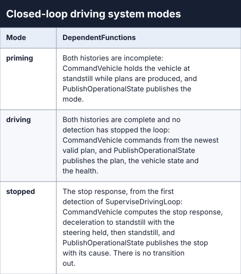

### `closedLoopDrivingFunctionalInterfaceView`

Systems engineers and software developers need the conceptual interfaces of the driving system before phase 7 allocates the functions and phase 8 places software on them: the port of the functional chain for each item that crosses its boundary, the direction of that item, and the item of phase 2 the port's item specializes.

- **Source:** `closed_loop_driving_functional_architecture.sysml`
- **Viewpoint:** `selectedFunctionalInterfaceViewpoint` (`SystemInterfaceDefinitionViewpoint`)
- **Concern:** `closedLoopDrivingInterfaceConcern`
- **Exposes:** `CameraImagesInbound`, `EgoMotionInbound`, `OperationalStateOutbound`, `RouteInbound`, `VehicleCommandOutbound`
- **Render:** `asTreeDiagram`

- **Diagram status:** Published from the committed SysIDE SVG.

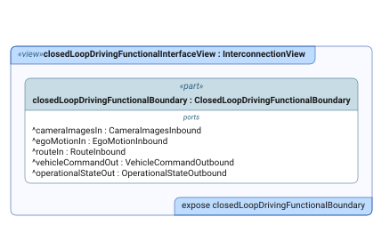

## `closed_loop_driving_logical_architecture.sysml`

### `closedLoopDrivingLogicalStructureView`

System architects and software developers need the logical elements of the driving system, one level inside its functional boundary, each with the responsibility it carries and its ports, before phase 8 places software on them: which elements there are, and why each stands alone.

- **Source:** `closed_loop_driving_logical_architecture.sysml`
- **Viewpoint:** `selectedLogicalStructureViewpoint` (`SystemStructureDefinitionViewpoint`)
- **Concern:** `closedLoopDrivingLogicalStructureConcern`
- **Exposes:** `closedLoopDrivingLogicalSystem`, `closedLoopDrivingLogicalSystem::inputConditioner`, `closedLoopDrivingLogicalSystem::planner`, `closedLoopDrivingLogicalSystem::loopSupervisor`, `closedLoopDrivingLogicalSystem::vehicleCommander`, `closedLoopDrivingLogicalSystem::actuationGateway`, `closedLoopDrivingLogicalSystem::statePublisher`
- **Render:** `asTreeDiagram`

- **Diagram status:** Published from the committed SysIDE SVG.

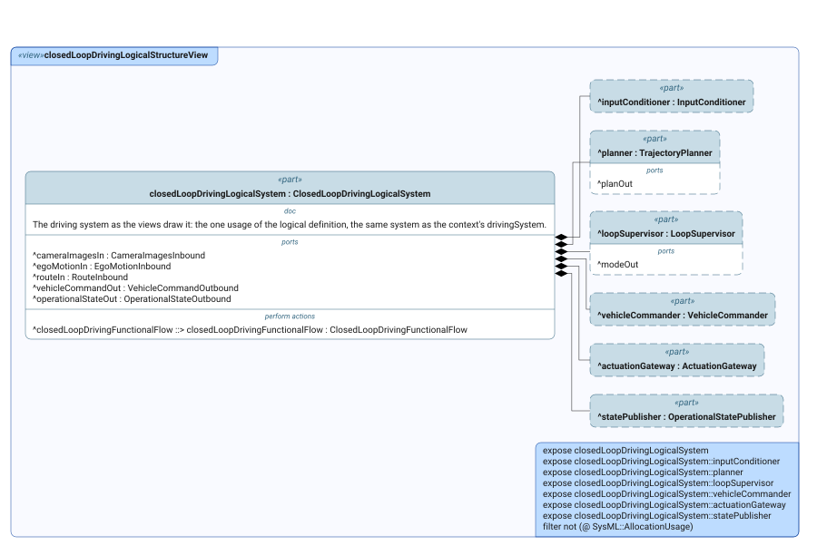

### `closedLoopDrivingFunctionMappingView`

System architects and verification engineers need each function of phase 6 allocated to the logical element that carries it, and each element carrying at least one function: phase 8 places the elements, and phase 10 verifies each requirement on the functions of its element.

- **Source:** `closed_loop_driving_logical_architecture.sysml`
- **Viewpoint:** `selectedFunctionMappingViewpoint` (`SystemFunctionMappingViewpoint`)
- **View type:** `MVD::MatrixView`
- **Concern:** `closedLoopDrivingFunctionMappingConcern`
- **Exposes:** `closedLoopDrivingFunctionalFlow::identifyRun`, `closedLoopDrivingFunctionalFlow::assembleInputs`, `closedLoopDrivingFunctionalFlow::planTrajectory`, `closedLoopDrivingFunctionalFlow::superviseLoop`, `closedLoopDrivingFunctionalFlow::commandVehicle`, `closedLoopDrivingFunctionalFlow::applyCommands`, `closedLoopDrivingFunctionalFlow::publishState`, `ClosedLoopDrivingLogicalSystem::inputConditioner`, `ClosedLoopDrivingLogicalSystem::planner`, `ClosedLoopDrivingLogicalSystem::loopSupervisor`, `ClosedLoopDrivingLogicalSystem::vehicleCommander`, `ClosedLoopDrivingLogicalSystem::actuationGateway`, `ClosedLoopDrivingLogicalSystem::statePublisher`, `DE4SDV_ClosedLoopDrivingLogicalArchitecture::*`

- **Diagram status:** Published from the committed SysIDE SVG.

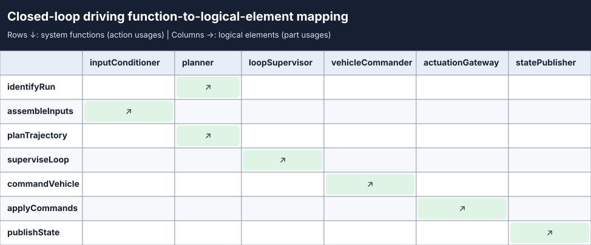

### `closedLoopDrivingInternalExchangeView`

Systems engineers and software developers need the exchanges between the logical elements of the driving system, the item each carries and its direction: the plan and the command exchanges that REQ-DRIVING-014 and REQ-DRIVING-028 constrain, the actuation state exchange that REQ-DRIVING-029 times, and the boundary items delegated to the elements that take or provide them.

- **Source:** `closed_loop_driving_logical_architecture.sysml`
- **Viewpoint:** `selectedInternalExchangeViewpoint` (`SystemInternalExchangeViewpoint`)
- **Concern:** `closedLoopDrivingInternalExchangeConcern`
- **Exposes:** `closedLoopDrivingLogicalSystem`, `closedLoopDrivingLogicalSystem::**`
- **Depth:** `-1`
- **Render:** `asInterconnectionDiagram`

- **Diagram status:** Published from the committed SysIDE SVG.

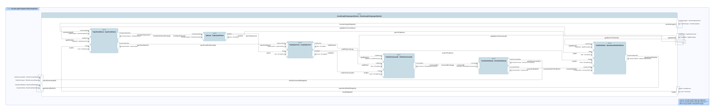

## `closed_loop_driving_needs_requirements.sysml`

### `closedLoopDrivingNeedsView`

Systems engineers and open-source reviewers need the stakeholder needs of the driving system with their statements and sources, and the planned stakeholder review of each, to judge whether the needs cover the concerns of phase 1.

- **Source:** `closed_loop_driving_needs_requirements.sysml`
- **Viewpoint:** `selectedNeedsViewpoint` (`StakeholderRequirementDefinitionViewpoint`)
- **View type:** `TVD::TableView`
- **Concern:** `closedLoopDrivingNeedsConcern`
- **Exposes:** `needDrivenAlongTheRoute`, `needPlansAndCommandsThroughSCORE`, `needLiveStateForAAOS`, `needLoopIndependentOfAAOS`, `needDefinedResponseToDegradedInputOrPlan`, `needTimesMeasurableInTheirOwnDomain`, `needRunsIdentifyCheckpointAndConfiguration`

- **Diagram status:** Published from the committed SysIDE SVG.

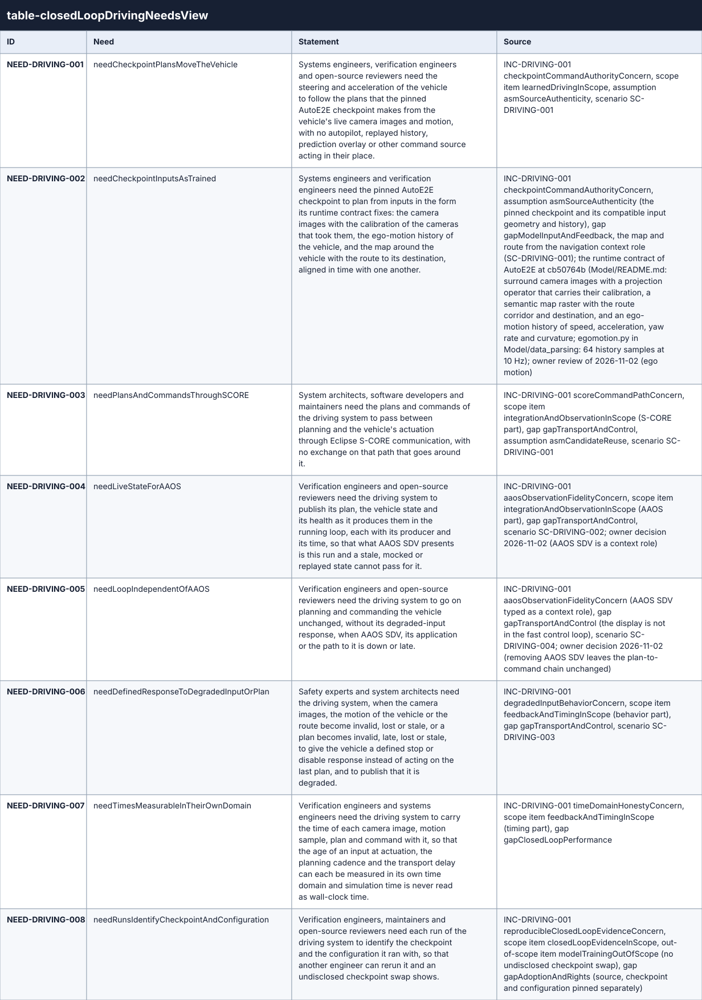

### `closedLoopDrivingNeedValidationView`

Systems engineers and open-source reviewers need the stakeholder needs of the driving system with their statements and sources, and the planned stakeholder review of each, to judge whether the needs cover the concerns of phase 1.

- **Source:** `closed_loop_driving_needs_requirements.sysml`
- **Viewpoint:** `selectedNeedValidationViewpoint` (`StakeholderRequirementDefinitionViewpoint`)
- **View type:** `TVD::TableView`
- **Concern:** `closedLoopDrivingNeedsConcern`
- **Exposes:** `checkpointAuthorityValidationPlan`, `scoreCommandPathValidationPlan`, `liveStateValidationPlan`, `aaosIndependenceValidationPlan`, `degradedResponseValidationPlan`, `timeDomainValidationPlan`, `rerunValidationPlan`

- **Diagram status:** Published from the committed SysIDE SVG.

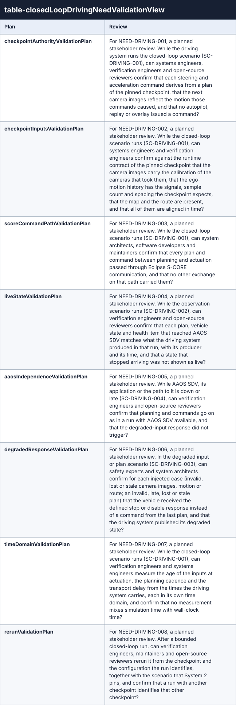

### `closedLoopDrivingRequirementsView`

Verification engineers and open-source reviewers need each requirement of the driving system traced to the need it derives from, with its verification method and success criteria, to judge whether the requirements answer the needs and can be verified.

- **Source:** `closed_loop_driving_needs_requirements.sysml`
- **Viewpoint:** `selectedRequirementTraceViewpoint` (`SystemRequirementTraceabilityViewpoint`)
- **View type:** `TVD::TableView`
- **Concern:** `closedLoopDrivingRequirementTraceConcern`
- **Exposes:** `reqPlanEachStep`, `reqPlansByCheckpointInference`, `reqCameraImagesInCheckpointForm`, `reqCameraHistory`, `reqProjectionOperators`, `reqMapContextRaster`, `reqRouteMaskRaster`, `reqEgoMotionHistory`, `reqHoldUntilHistoriesComplete`, `reqHistoriesFromCapturedInputs`, `reqCommandsFromNewestValidPlan`, `reqCommandsWithinActuationLimits`, `reqPlanWithinPlanningPeriod`, `reqPlansAndCommandsOverSCORE`, `reqPublishPlans`, `reqPublishVehicleState`, `reqPublishHealthPeriodically`, `reqPlansIndependentOfObservation`, `reqPlanningTimeIndependentOfObservation`, `reqStopResponseDeceleration`, `reqStopResponseSteeringHeld`, `reqStandstillAfterStop`, `reqStopOnDegradedCameraImages`, `reqStopOnDegradedMotion`, `reqStopOnDegradedRoute`, `reqStopOnStalePlan`, `reqStopOnInvalidPlan`, `reqStopOnLostCommands`, `reqPublishStop`, `reqStampInputs`, `reqStampPlans`, `reqStampCommands`, `reqRecordRunIdentity`, `reqPlansNameRunRecord`, `reqRefuseUnpinnedCheckpoint`

- **Diagram status:** Published from the committed SysIDE SVG.
- **Presentation note:** This is a dense review artifact; open the SVG at full size rather than reading it from the page thumbnail.

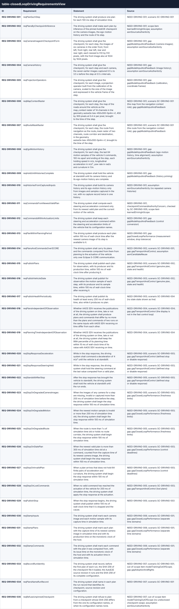

### `closedLoopDrivingRequirementVerificationView`

Verification engineers and open-source reviewers need each requirement of the driving system traced to the need it derives from, with its verification method and success criteria, to judge whether the requirements answer the needs and can be verified.

- **Source:** `closed_loop_driving_needs_requirements.sysml`
- **Viewpoint:** `selectedRequirementVerificationViewpoint` (`SystemRequirementTraceabilityViewpoint`)
- **View type:** `TVD::TableView`
- **Concern:** `closedLoopDrivingRequirementTraceConcern`
- **Exposes:** `reqPlanEachStep`, `reqPlansByCheckpointInference`, `reqCameraImagesInCheckpointForm`, `reqCameraHistory`, `reqProjectionOperators`, `reqMapContextRaster`, `reqRouteMaskRaster`, `reqEgoMotionHistory`, `reqHoldUntilHistoriesComplete`, `reqHistoriesFromCapturedInputs`, `reqCommandsFromNewestValidPlan`, `reqCommandsWithinActuationLimits`, `reqPlanWithinPlanningPeriod`, `reqPlansAndCommandsOverSCORE`, `reqPublishPlans`, `reqPublishVehicleState`, `reqPublishHealthPeriodically`, `reqPlansIndependentOfObservation`, `reqPlanningTimeIndependentOfObservation`, `reqStopResponseDeceleration`, `reqStopResponseSteeringHeld`, `reqStandstillAfterStop`, `reqStopOnDegradedCameraImages`, `reqStopOnDegradedMotion`, `reqStopOnDegradedRoute`, `reqStopOnStalePlan`, `reqStopOnInvalidPlan`, `reqStopOnLostCommands`, `reqPublishStop`, `reqStampInputs`, `reqStampPlans`, `reqStampCommands`, `reqRecordRunIdentity`, `reqPlansNameRunRecord`, `reqRefuseUnpinnedCheckpoint`

- **Diagram status:** Published from the committed SysIDE SVG.
- **Presentation note:** This is a dense review artifact; open the SVG at full size rather than reading it from the page thumbnail.

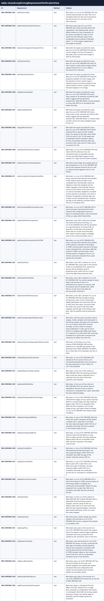

## `closed_loop_driving_operational_context.sysml`

### `closedLoopDrivingOperationalContextView`

System architects, systems engineers and open-source reviewers need to see what is inside the driving system and what is around it: the vehicle, the road environment, navigation, AAOS SDV and the driver, and which items cross the boundary in which direction.

- **Source:** `closed_loop_driving_operational_context.sysml`
- **Viewpoint:** `closedLoopDrivingContextViewpoint` (`OperationalContextDefinitionViewpoint`)
- **Concern:** `closedLoopDrivingContextConcern`
- **Exposes:** `closedLoopDrivingOperationalContext`, `closedLoopDrivingOperationalContext::*`, `closedLoopDrivingOperation`
- **Depth:** `2`
- **Render:** `asTreeDiagram`

- **Diagram status:** Published from the committed SysIDE SVG.
- **Presentation note:** SysIDE lists the actions of `closedLoopDrivingOperation` but does not draw the flows between them. The flows are modeled in the source, in the action definition `ClosedLoopDrivingOperation`: camera images and ego motion from the vehicle into planning, steering and acceleration commands to the vehicle, and the published plan, vehicle state and health to AAOS SDV, with no flow back into the loop.

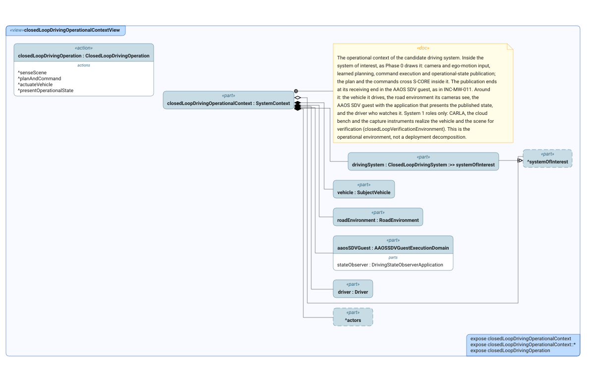

### `closedLoopDrivingOperationalStoryView`

Systems engineers, verification engineers and open-source reviewers need the loop told in stakeholder language: driving on the checkpoint's plans, the live state on AAOS SDV, the response to degraded input or plan, and the loop without AAOS SDV.

- **Source:** `closed_loop_driving_operational_context.sysml`
- **Viewpoint:** `closedLoopDrivingStoryViewpoint` (`OperationalStoryViewpoint`)
- **Concern:** `closedLoopDrivingStoryConcern`
- **Exposes:** `driveBoundedScenarioClosedLoop`, `driveBoundedScenarioClosedLoop::*`
- **Depth:** `1`
- **Render:** `asTreeDiagram`

- **Diagram status:** Published from the committed SysIDE SVG.

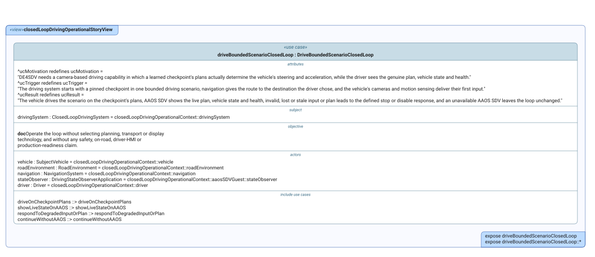

## `closed_loop_driving_physical_software_realization.sysml`

### `closedLoopDrivingPhysicalStructureView`

System architects and software developers need the software and platform elements that realize the driving system on the bench, as they nest: the three hosts with their platform layers, the S-CORE services, the three programs and the four activities of the agent, the route provider, the simulator with its rig, the hypervisor and the two AAOS SDV guests.

- **Source:** `closed_loop_driving_physical_software_realization.sysml`
- **Viewpoint:** `selectedPhysicalStructureViewpoint` (`PhysicalStructureDefinitionViewpoint`)
- **Concern:** `closedLoopDrivingPhysicalStructureConcern`
- **Exposes:** `closedLoopDrivingPhysicalSystem`, `closedLoopDrivingPhysicalSystem::linuxHost`, `closedLoopDrivingPhysicalSystem::linuxHost::os`, `closedLoopDrivingPhysicalSystem::linuxHost::drivingSoftware`, `closedLoopDrivingPhysicalSystem::linuxHost::drivingSoftware::drivingAgent`, `closedLoopDrivingPhysicalSystem::linuxHost::drivingSoftware::drivingAgent::conditionInputs`, `closedLoopDrivingPhysicalSystem::linuxHost::drivingSoftware::drivingAgent::inferPlan`, `closedLoopDrivingPhysicalSystem::linuxHost::drivingSoftware::drivingAgent::superviseLoop`, `closedLoopDrivingPhysicalSystem::linuxHost::drivingSoftware::drivingAgent::commandVehicle`, `closedLoopDrivingPhysicalSystem::linuxHost::drivingSoftware::actuationAdapter`, `closedLoopDrivingPhysicalSystem::linuxHost::drivingSoftware::statePublisherApplication`, `closedLoopDrivingPhysicalSystem::linuxHost::drivingSoftware::scoreServices`, `closedLoopDrivingPhysicalSystem::linuxHost::drivingSoftware::scoreServices::launchManager`, `closedLoopDrivingPhysicalSystem::linuxHost::drivingSoftware::scoreServices::gatewayd`, `closedLoopDrivingPhysicalSystem::linuxHost::drivingSoftware::scoreServices::someipd`, `closedLoopDrivingPhysicalSystem::linuxHost::routeProvider`, `closedLoopDrivingPhysicalSystem::simulatorHost`, `closedLoopDrivingPhysicalSystem::simulatorHost::os`, `closedLoopDrivingPhysicalSystem::simulatorHost::carlaServer`, `closedLoopDrivingPhysicalSystem::simulatorHost::carlaServer::sensorRig`, `closedLoopDrivingPhysicalSystem::simulatorHost::carlaServer::sensorRig::frontCamera`, `closedLoopDrivingPhysicalSystem::simulatorHost::carlaServer::sensorRig::frontLeftCamera`, `closedLoopDrivingPhysicalSystem::simulatorHost::carlaServer::sensorRig::frontRightCamera`, `closedLoopDrivingPhysicalSystem::simulatorHost::carlaServer::sensorRig::rearLeftCamera`, `closedLoopDrivingPhysicalSystem::simulatorHost::carlaServer::sensorRig::rearCamera`, `closedLoopDrivingPhysicalSystem::simulatorHost::carlaServer::sensorRig::rearRightCamera`, `closedLoopDrivingPhysicalSystem::simulatorHost::carlaServer::sensorRig::egoMotionSource`, `closedLoopDrivingPhysicalSystem::guestHost`, `closedLoopDrivingPhysicalSystem::guestHost::os`, `closedLoopDrivingPhysicalSystem::guestHost::hypervisor`, `closedLoopDrivingPhysicalSystem::sdvCoreGuest`, `closedLoopDrivingPhysicalSystem::sdvCoreGuest::os`, `closedLoopDrivingPhysicalSystem::sdvCoreGuest::sdvMiddleware`, `closedLoopDrivingPhysicalSystem::sdvCoreGuest::sdvCore`, `closedLoopDrivingPhysicalSystem::hmiGuest`, `closedLoopDrivingPhysicalSystem::hmiGuest::os`, `closedLoopDrivingPhysicalSystem::hmiGuest::sdvGateway`, `closedLoopDrivingPhysicalSystem::hmiGuest::stateObserver`
- **Render:** `asTreeDiagram`

- **Diagram status:** Published from the committed SysIDE SVG.
- **Presentation note:** This is a dense review artifact; open the SVG at full size rather than reading it from the page thumbnail.

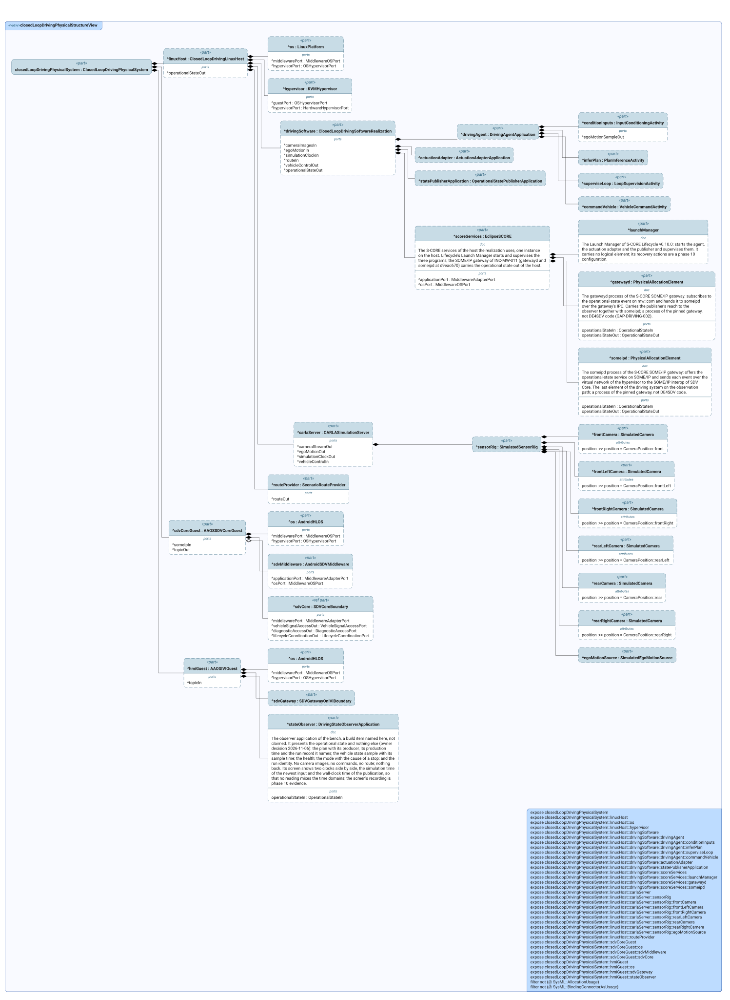

### `closedLoopDrivingPhysicalLogicalMappingView`

System architects, verification engineers and open-source reviewers need each logical element of phase 7 allocated to the software element that carries it, and each software element carrying one: the four activities of the agent, the actuation adapter, the publisher, and the two gateway processes the publisher reaches the observer through.

- **Source:** `closed_loop_driving_physical_software_realization.sysml`
- **Viewpoint:** `selectedPhysicalLogicalMappingViewpoint` (`PhysicalLogicalMappingViewpoint`)
- **View type:** `MVD::MatrixView`
- **Concern:** `closedLoopDrivingPhysicalAllocationConcern`
- **Exposes:** `ClosedLoopDrivingLogicalSystem::inputConditioner`, `ClosedLoopDrivingLogicalSystem::planner`, `ClosedLoopDrivingLogicalSystem::loopSupervisor`, `ClosedLoopDrivingLogicalSystem::vehicleCommander`, `ClosedLoopDrivingLogicalSystem::actuationGateway`, `ClosedLoopDrivingLogicalSystem::statePublisher`, `closedLoopDrivingPhysicalSystem::linuxHost::drivingSoftware::drivingAgent::conditionInputs`, `closedLoopDrivingPhysicalSystem::linuxHost::drivingSoftware::drivingAgent::inferPlan`, `closedLoopDrivingPhysicalSystem::linuxHost::drivingSoftware::drivingAgent::superviseLoop`, `closedLoopDrivingPhysicalSystem::linuxHost::drivingSoftware::drivingAgent::commandVehicle`, `closedLoopDrivingPhysicalSystem::linuxHost::drivingSoftware::actuationAdapter`, `closedLoopDrivingPhysicalSystem::linuxHost::drivingSoftware::statePublisherApplication`, `closedLoopDrivingPhysicalSystem::linuxHost::drivingSoftware::scoreServices::gatewayd`, `closedLoopDrivingPhysicalSystem::linuxHost::drivingSoftware::scoreServices::someipd`, `DE4SDV_ClosedLoopDrivingPhysicalSoftwareRealization::*`

- **Diagram status:** Published from the committed SysIDE SVG.

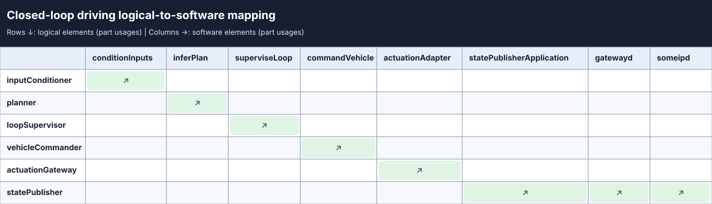

### `closedLoopDrivingSCOREPathExchangeView`

Shows the model elements selected to address the score command path concern.

- **Source:** `closed_loop_driving_physical_software_realization.sysml`
- **Viewpoint:** `selectedPhysicalInternalExchangeViewpoint` (`PhysicalInternalExchangeViewpoint`)
- **Concern:** `scoreCommandPathConcern`
- **Exposes:** `closedLoopDrivingSoftware`, `closedLoopDrivingSoftware::**`
- **Depth:** `-1`
- **Render:** `asInterconnectionDiagram`

- **Diagram status:** Published from the committed SysIDE SVG.
- **Presentation note:** This is a dense review artifact; open the SVG at full size rather than reading it from the page thumbnail.

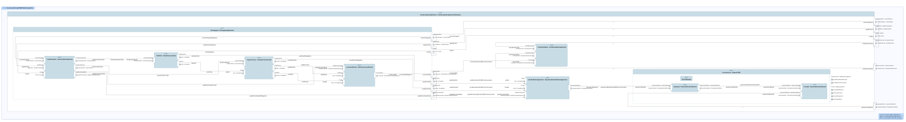

### `closedLoopDrivingPhysicalContextExchangeView`

Shows the model elements selected to address the aaos observation fidelity concern.

- **Source:** `closed_loop_driving_physical_software_realization.sysml`
- **Viewpoint:** `selectedPhysicalContextExchangeViewpoint` (`PhysicalContextExchangeViewpoint`)
- **Concern:** `aaosObservationFidelityConcern`
- **Exposes:** `closedLoopDrivingPhysicalSystem`, `closedLoopDrivingPhysicalSystem::linuxHost`, `closedLoopDrivingPhysicalSystem::linuxHost::cameraImagesIn`, `closedLoopDrivingPhysicalSystem::linuxHost::egoMotionIn`, `closedLoopDrivingPhysicalSystem::linuxHost::simulationClockIn`, `closedLoopDrivingPhysicalSystem::linuxHost::vehicleControlOut`, `closedLoopDrivingPhysicalSystem::linuxHost::operationalStateOut`, `closedLoopDrivingPhysicalSystem::linuxHost::drivingSoftware`, `closedLoopDrivingPhysicalSystem::linuxHost::drivingSoftware::cameraImagesIn`, `closedLoopDrivingPhysicalSystem::linuxHost::drivingSoftware::egoMotionIn`, `closedLoopDrivingPhysicalSystem::linuxHost::drivingSoftware::routeIn`, `closedLoopDrivingPhysicalSystem::linuxHost::drivingSoftware::simulationClockIn`, `closedLoopDrivingPhysicalSystem::linuxHost::drivingSoftware::vehicleControlOut`, `closedLoopDrivingPhysicalSystem::linuxHost::drivingSoftware::operationalStateOut`, `closedLoopDrivingPhysicalSystem::linuxHost::routeProvider`, `closedLoopDrivingPhysicalSystem::linuxHost::routeProvider::routeOut`, `closedLoopDrivingPhysicalSystem::linuxHost::cameraImagesDelegation`, `closedLoopDrivingPhysicalSystem::linuxHost::egoMotionDelegation`, `closedLoopDrivingPhysicalSystem::linuxHost::simulationClockDelegation`, `closedLoopDrivingPhysicalSystem::linuxHost::routeFromScenario`, `closedLoopDrivingPhysicalSystem::linuxHost::vehicleControlDelegation`, `closedLoopDrivingPhysicalSystem::linuxHost::operationalStateDelegation`, `closedLoopDrivingPhysicalSystem::simulatorHost`, `closedLoopDrivingPhysicalSystem::simulatorHost::cameraStreamOut`, `closedLoopDrivingPhysicalSystem::simulatorHost::egoMotionOut`, `closedLoopDrivingPhysicalSystem::simulatorHost::simulationClockOut`, `closedLoopDrivingPhysicalSystem::simulatorHost::vehicleControlIn`, `closedLoopDrivingPhysicalSystem::simulatorHost::carlaServer`, `closedLoopDrivingPhysicalSystem::simulatorHost::carlaServer::cameraStreamOut`, `closedLoopDrivingPhysicalSystem::simulatorHost::carlaServer::egoMotionOut`, `closedLoopDrivingPhysicalSystem::simulatorHost::carlaServer::simulationClockOut`, `closedLoopDrivingPhysicalSystem::simulatorHost::carlaServer::vehicleControlIn`, `closedLoopDrivingPhysicalSystem::simulatorHost::cameraStreamDelegation`, `closedLoopDrivingPhysicalSystem::simulatorHost::egoMotionDelegation`, `closedLoopDrivingPhysicalSystem::simulatorHost::simulationClockDelegation`, `closedLoopDrivingPhysicalSystem::simulatorHost::vehicleControlDelegation`, `closedLoopDrivingPhysicalSystem::sdvCoreGuest`, `closedLoopDrivingPhysicalSystem::sdvCoreGuest::someIpIn`, `closedLoopDrivingPhysicalSystem::sdvCoreGuest::topicOut`, `closedLoopDrivingPhysicalSystem::hmiGuest`, `closedLoopDrivingPhysicalSystem::hmiGuest::topicIn`, `closedLoopDrivingPhysicalSystem::cameraStreamOverBenchNetwork`, `closedLoopDrivingPhysicalSystem::egoMotionOverBenchNetwork`, `closedLoopDrivingPhysicalSystem::simulationClockOverBenchNetwork`, `closedLoopDrivingPhysicalSystem::vehicleControlOverBenchNetwork`, `closedLoopDrivingPhysicalSystem::operationalStateOverSOMEIPAcrossVXLANSegment`, `closedLoopDrivingPhysicalSystem::operationalStateTopicOverDataTunnelAcrossVMs`
- **Depth:** `-1`
- **Render:** `asInterconnectionDiagram`

- **Diagram status:** Published from the committed SysIDE SVG.
- **Presentation note:** This is a dense review artifact; open the SVG at full size rather than reading it from the page thumbnail.

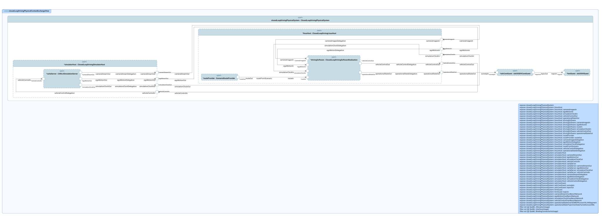

## `closed_loop_driving_variability_configuration.sysml`

### `closedLoopDrivingProductLineConfigurationView`

Product-line engineers, system architects and open-source reviewers need the variant selections of DRIVING-CONFIG-001 in the platform-stack projection that the configurator generates from its receipt.

- **Source:** `closed_loop_driving_variability_configuration.sysml`
- **Viewpoint:** `selectedProductLineConfigurationViewpoint` (`ProductLineConfigurationViewpoint`)
- **Concern:** `drivingProductLineConfigurationConcern`
- **Exposes:** `ClosedLoopDrivingAutoE2ESCOREReference`, `selectedVehicleApplication`, `selectedMiddleware`, `selectedOperatingSystem`, `selectedHypervisor`, `selectedGuestOperatingSystem`, `selectedGuestMiddleware`, `selectedApplicationMiddlewareAdapter`
- **Render:** `asTreeDiagram`

- **Diagram status:** Published from the committed SysIDE SVG.

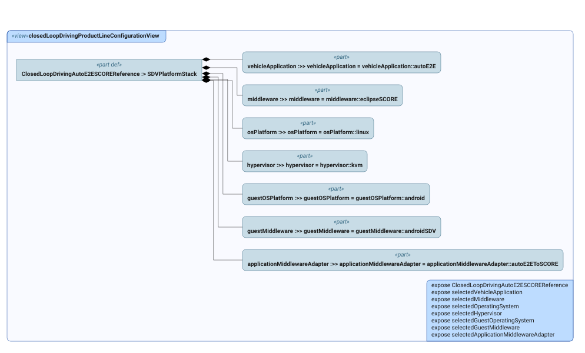

### `closedLoopDrivingProductModelAssemblyView`

System architects, verification engineers and open-source reviewers need the assembly of DRIVING-CONFIG-001: the platform-stack projection and the realization of the driving system, and the one binding that makes the S-CORE services of the realization the selected middleware.

- **Source:** `closed_loop_driving_variability_configuration.sysml`
- **Viewpoint:** `selectedProductModelAssemblyViewpoint` (`ProductModelAssemblyViewpoint`)
- **Concern:** `drivingProductModelAssemblyConcern`
- **Exposes:** `ClosedLoopDrivingAutoE2ESCOREConfiguredProduct`, `ClosedLoopDrivingAutoE2ESCOREConfiguredProduct::platformStack`, `ClosedLoopDrivingAutoE2ESCOREConfiguredProduct::drivingSoftware`, `ClosedLoopDrivingAutoE2ESCOREConfiguredProduct::scoreServicesBoundToSelectedMiddleware`
- **Render:** `asTreeDiagram`

- **Diagram status:** Published from the committed SysIDE SVG.

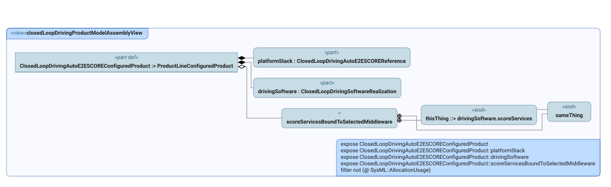

## `closed_loop_driving_verification_evidence.sysml`

### `closedLoopDrivingAssuranceView`

Systems engineers, verification engineers and open-source reviewers need the claims of the increment stated before any run, each with the argument that will support it and the cases that argument cites, the record each run retains, and the limits the counter-claims disclose, so that the evidence of phase 10 is judged against claims written first and not fitted to results.

- **Source:** `closed_loop_driving_verification_evidence.sysml`
- **Viewpoint:** `selectedAssuranceViewpoint` (`ArgumentationAssuranceViewpoint`)
- **Concern:** `drivingArgumentationAssuranceConcern`
- **Exposes:** `drivenAlongTheRouteClaim`, `checkpointCommandAuthorityClaim`, `scoreCommandPathClaim`, `observationFidelityClaim`, `degradedInputBehaviorClaim`, `timeDomainHonestyClaim`, `reproducibleClosedLoopEvidenceClaim`, `drivenAlongTheRouteArgument`, `checkpointCommandAuthorityArgument`, `scoreCommandPathArgument`, `observationFidelityArgument`, `degradedInputBehaviorArgument`, `timeDomainHonestyArgument`, `reproducibleClosedLoopEvidenceArgument`, `counterClaimSimulatedSensorsAndDynamics`, `counterClaimNoRealTimeOnTarget`, `counterClaimNoSafetyOrCertification`, `counterClaimNoMembership`, `counterClaimCheckpointRightsAndTransfer`, `counterClaimBoundedFaults`, `counterClaimEnvironmentOpenNoVerdict`, `planPerStepVerification`, `planByCheckpointInferenceVerification`, `cameraImagesInCheckpointFormVerification`, `cameraHistoryVerification`, `projectionOperatorsVerification`, `mapContextRasterVerification`, `routeMaskRasterVerification`, `egoMotionHistoryVerification`, `holdUntilHistoriesCompleteVerification`, `historiesFromCapturedInputsVerification`, `commandsFromNewestValidPlanVerification`, `commandsWithinActuationLimitsVerification`, `planWithinPlanningPeriodVerification`, `plansAndCommandsOverSCOREVerification`, `publishPlansVerification`, `publishVehicleStateVerification`, `publishHealthPeriodicallyVerification`, `plansIndependentOfObservationVerification`, `planningTimeIndependentOfObservationVerification`, `stopResponseDecelerationVerification`, `stopResponseSteeringHeldVerification`, `standstillAfterStopVerification`, `stopOnDegradedCameraImagesVerification`, `stopOnDegradedMotionVerification`, `stopOnDegradedRouteVerification`, `stopOnStalePlanVerification`, `stopOnInvalidPlanVerification`, `stopOnLostCommandsVerification`, `publishStopVerification`, `stampInputsVerification`, `stampPlansVerification`, `stampCommandsVerification`, `recordRunIdentityVerification`, `plansNameRunRecordVerification`, `refuseUnpinnedCheckpointVerification`, `RetainedDrivingRunEvidence`, `ClosedLoopDrivingVerificationBench`, `gapDrivingVerificationEnvironmentOpen`, `asmSimulatedSensorsStandForTheVehicles`, `gapClosedLoopPerformance`, `roadDeploymentOutOfScope`, `gapProductLineAdmission`, `gapAdoptionAndRights`, `gapModelInputAndFeedback`, `claimSupportedByDrivenAlongTheRouteArgument`, `claimSupportedByCheckpointCommandAuthorityArgument`, `claimSupportedByScoreCommandPathArgument`, `claimSupportedByObservationFidelityArgument`, `claimSupportedByDegradedInputBehaviorArgument`, `claimSupportedByTimeDomainHonestyArgument`, `claimSupportedByReproducibleClosedLoopEvidenceArgument`, `drivenAlongTheRouteArgumentCitesCases`, `checkpointCommandAuthorityArgumentCitesCases`, `scoreCommandPathArgumentCitesCases`, `observationFidelityArgumentCitesCases`, `degradedInputBehaviorArgumentCitesCases`, `timeDomainHonestyArgumentCitesCases`, `reproducibleClosedLoopEvidenceArgumentCitesCases`, `counterClaimSimulatedSensorsAndDynamicsBoundTo`, `counterClaimNoRealTimeOnTargetBoundTo`, `counterClaimNoSafetyOrCertificationBoundTo`, `counterClaimNoMembershipBoundTo`, `counterClaimCheckpointRightsAndTransferBoundTo`, `counterClaimBoundedFaultsBoundTo`, `counterClaimEnvironmentOpenNoVerdictBoundTo`
- **Render:** `asTreeDiagram`

- **Diagram status:** Published from the committed SysIDE SVG.
- **Presentation note:** This is a dense review artifact; open the SVG at full size rather than reading it from the page thumbnail.

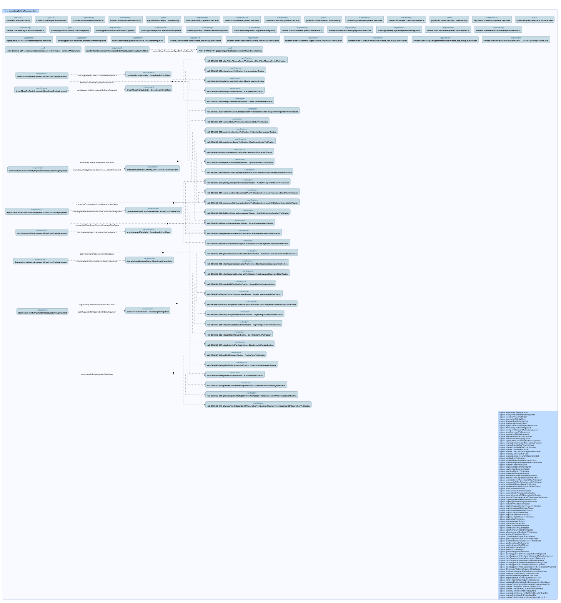

## `driver_assistance_framing.sysml`

### `driverAssistanceFramingView`

Shows the model elements selected to address the driver assistance boundary concern.

- **Source:** `driver_assistance_framing.sysml`
- **Viewpoint:** `driverAssistanceFramingViewpoint` (`IncrementFramingViewpoint`)
- **Concern:** `driverAssistanceBoundary`
- **Exposes:** `DriverAssistanceIncrement`, `driverAssistanceIncrement`, `driverAssistanceProblem`, `driverAssistanceQuestion`, `driverAssistanceDecision`, `candidateDriverAssistanceSystem`, `driverAssistanceScope`, `driverAssistanceBoundary`, `vehicleTargetResponseConcern`, `emergencyBrakingIndependenceConcern`, `driverWarningSequenceConcern`, `scoreCommandAndWarningPathConcern`, `vehicleTargetCriteriaConcern`, `candidateVerdictConcern`, `vehicleTargetResponseInScope`, `driverWarningInScope`, `noReactionInScope`, `vehicleTargetCriteriaInScope`, `scoreCommandPathInScope`, `verdictEvidenceInScope`, `pedestrianAndBicycleTargetsOutOfScope`, `cruiseAndLaneKeepingQualityOutOfScope`, `driverInteractionOutOfScope`, `furtherWarningProvisionsOutOfScope`, `existingAEBSOutOfScope`, `candidateTuningOutOfScope`, `onRoadOperationOutOfScope`, `driverAssistanceCharter`, `driverAssistanceVerificationEnvironment`, `asmSimulatorPathUsable`, `asmProcessorInferenceSufficient`, `asmBenchReuse`, `asmSimulatedConfigurationStandsIn`, `gapVehicleTargetCriteria`, `gapNoSeparateEmergencyFunction`, `gapWarningOutput`, `gapCandidateBehaviorUnverified`, `gapScoreIntegration`, `gapCameraImageAndGeometry`, `gapCandidateAdmission`, `gapUpstreamContactAndRights`, `gapDriverHmiInProductLine`
- **Render:** `asTreeDiagram`

- **Diagram status:** Published from the committed SysIDE SVG.
- **Presentation note:** This is a dense review artifact; open the SVG at full size rather than reading it from the page thumbnail.

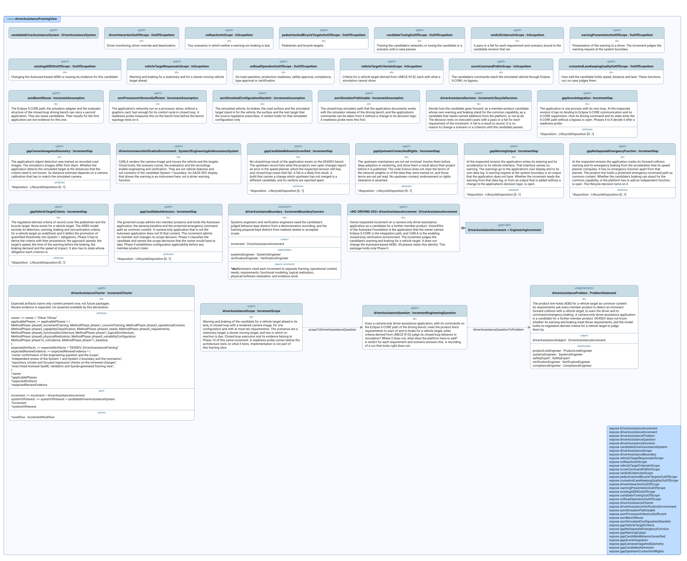

## `driver_assistance_operational_context.sysml`

### `driverAssistanceOperationalContextView`

System architects, systems engineers and open-source reviewers need to see what is inside the candidate and what is around it: the vehicle, the road environment, the vehicle targets, the Eclipse S-CORE path, the AAOS SDV and the driver, and which items cross the boundary in which direction.

- **Source:** `driver_assistance_operational_context.sysml`
- **Viewpoint:** `driverAssistanceContextViewpoint` (`OperationalContextDefinitionViewpoint`)
- **Concern:** `driverAssistanceContextConcern`
- **Exposes:** `driverAssistanceOperationalContext`, `driverAssistanceOperationalContext::*`, `driverAssistanceOperation`
- **Depth:** `2`
- **Render:** `asTreeDiagram`

- **Diagram status:** Not yet published in this folder.

_Diagram not present: `diagrams/diagram-driverAssistanceOperationalContextView.svg` (regenerate via the Privileged Syside Validation workflow)._

### `driverAssistanceOperationalStoryView`

Systems engineers, verification engineers and open-source reviewers need the candidate told in stakeholder language: the warning and the braking for a stationary and for a slower moving vehicle target ahead, and no reaction where none is due.

- **Source:** `driver_assistance_operational_context.sysml`
- **Viewpoint:** `driverAssistanceStoryViewpoint` (`OperationalStoryViewpoint`)
- **Concern:** `driverAssistanceStoryConcern`
- **Exposes:** `driverAssistanceStory`, `driverAssistanceStory::*`
- **Depth:** `1`
- **Render:** `asTreeDiagram`

- **Diagram status:** Not yet published in this folder.

_Diagram not present: `diagrams/diagram-driverAssistanceOperationalStoryView.svg` (regenerate via the Privileged Syside Validation workflow)._
