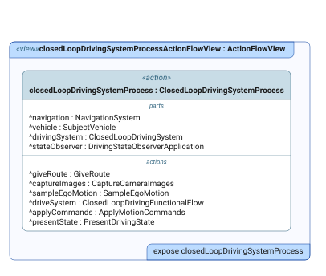
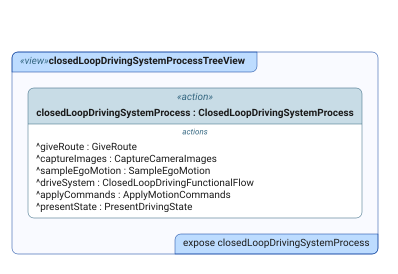
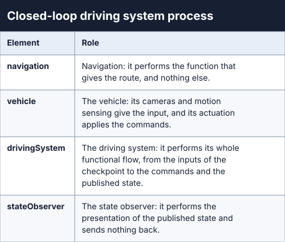
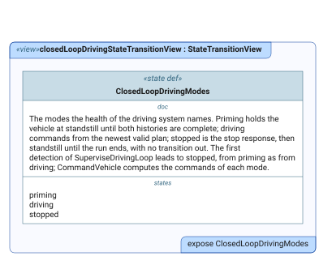
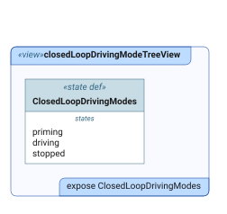
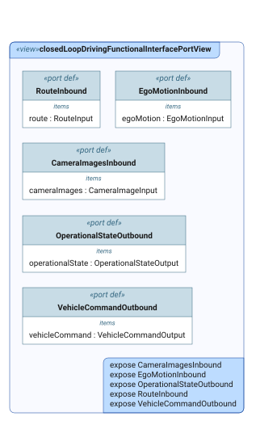

# Driving Views

This index lists every SysML v2 `view` declared in the `.sysml` files of
this first-level model area. Each entry explains the reviewer question in
plain language and embeds the committed diagram SysIDE renders from the
view (`syside viz view`, run by the Privileged Syside Validation workflow).
The SVGs live in [`diagrams/`](diagrams/) beside the model files.

Generated by `scripts/generate_view_index.py` — do not edit by hand.

**5 files, 18 views, 18 published diagrams.**

## `closed_loop_driving_capability_classification.sysml`

### `closedLoopDrivingClassificationView`

Product-line engineers and systems engineers need the driving stack identified as the feature candidate that distinguishes the driving member, with what it requires of the sensing and the deferred scope it turns into variability.

- **Source:** `closed_loop_driving_capability_classification.sysml`
- **Viewpoint:** `selectedProductLineClassificationViewpoint` (`ProductLineClassificationViewpoint`)
- **View type:** `TVD::TableView`
- **Concern:** `closedLoopDrivingClassificationConcern`
- **Exposes:** `autoE2EDrivingStack`

- **Diagram status:** Published from the committed SysIDE SVG.

## `closed_loop_driving_framing.sysml`

### `closedLoopDrivingFramingView`

Shows the model elements selected to address the closed loop driving boundary concern.

- **Source:** `closed_loop_driving_framing.sysml`
- **Viewpoint:** `closedLoopDrivingFramingViewpoint` (`IncrementFramingViewpoint`)
- **Concern:** `closedLoopDrivingBoundary`
- **Exposes:** `ClosedLoopDrivingIncrement`, `closedLoopDrivingIncrement`, `closedLoopDrivingProblem`, `closedLoopDrivingQuestion`, `closedLoopDrivingDecision`, `candidateDrivingSystem`, `closedLoopDrivingScope`, `closedLoopDrivingBoundary`, `drivenAlongTheRouteConcern`, `checkpointCommandAuthorityConcern`, `scoreCommandPathConcern`, `aaosObservationFidelityConcern`, `degradedInputBehaviorConcern`, `timeDomainHonestyConcern`, `reproducibleClosedLoopEvidenceConcern`, `learnedDrivingInScope`, `integrationAndObservationInScope`, `feedbackAndTimingInScope`, `closedLoopEvidenceInScope`, `roadDeploymentOutOfScope`, `existingAEBSBehaviorOutOfScope`, `modelTrainingOutOfScope`, `closedLoopDrivingCharter`, `closedLoopVerificationEnvironment`, `asmEngineeringUse`, `asmSourceAuthenticity`, `asmCandidateReuse`, `gapClosedLoopPerformance`, `gapModelInputAndFeedback`, `gapTransportAndControl`, `gapProductLineAdmission`, `gapAdoptionAndRights`, `gapBoundedCloudCampaign`
- **Render:** `asTreeDiagram`

- **Diagram status:** Published from the committed SysIDE SVG.
- **Presentation note:** This is a dense review artifact; open the SVG at full size rather than reading it from the page thumbnail.

## `closed_loop_driving_functional_architecture.sysml`

### `closedLoopDrivingFunctionBreakdownView`

System architects and verification engineers need the functions of the driving system and each requirement of phase 5 mapped to the functions that carry it: phase 7 gives the functions to logical elements, and phase 10 verifies each requirement on its functions.

- **Source:** `closed_loop_driving_functional_architecture.sysml`
- **Viewpoint:** `selectedFunctionalBreakdownViewpoint` (`SystemFunctionalBreakdownStructureViewpoint`)
- **Concern:** `closedLoopDrivingFunctionsConcern`
- **Exposes:** `closedLoopDrivingFunctionalFlow`
- **Render:** `asTreeDiagram`

- **Diagram status:** Published from the committed SysIDE SVG.
- **Presentation note:** SysIDE lists the items and the seven functions of `closedLoopDrivingFunctionalFlow` but does not draw the flows between them. The flows are modeled in the source, in the action definition `ClosedLoopDrivingFunctionalFlow`, and the requirements each function carries are in `closedLoopDrivingRequirementFunctionMappingView`.

### `closedLoopDrivingRequirementFunctionMappingView`

System architects and verification engineers need the functions of the driving system and each requirement of phase 5 mapped to the functions that carry it: phase 7 gives the functions to logical elements, and phase 10 verifies each requirement on its functions.

- **Source:** `closed_loop_driving_functional_architecture.sysml`
- **Viewpoint:** `selectedRequirementFunctionViewpoint` (`SystemFunctionalBreakdownStructureViewpoint`)
- **View type:** `MVD::MatrixView`
- **Concern:** `closedLoopDrivingFunctionsConcern`
- **Exposes:** `reqPlanEachStep`, `reqPlansByCheckpointInference`, `reqCameraImagesInCheckpointForm`, `reqCameraHistory`, `reqProjectionOperators`, `reqMapContextRaster`, `reqRouteMaskRaster`, `reqEgoMotionHistory`, `reqHoldUntilHistoriesComplete`, `reqHistoriesFromCapturedInputs`, `reqCommandsFromNewestValidPlan`, `reqCommandsWithinActuationLimits`, `reqPlanWithinPlanningPeriod`, `reqPlansAndCommandsOverSCORE`, `reqPublishPlans`, `reqPublishVehicleState`, `reqPublishHealthPeriodically`, `reqPlansIndependentOfObservation`, `reqPlanningTimeIndependentOfObservation`, `reqStopResponseDeceleration`, `reqStopResponseSteeringHeld`, `reqStandstillAfterStop`, `reqStopOnDegradedCameraImages`, `reqStopOnDegradedMotion`, `reqStopOnDegradedRoute`, `reqStopOnStalePlan`, `reqStopOnInvalidPlan`, `reqStopOnLostCommands`, `reqPublishStop`, `reqStampInputs`, `reqStampPlans`, `reqStampCommands`, `reqRecordRunIdentity`, `reqPlansNameRunRecord`, `reqRefuseUnpinnedCheckpoint`, `closedLoopDrivingFunctionalFlow::identifyRun`, `closedLoopDrivingFunctionalFlow::assembleInputs`, `closedLoopDrivingFunctionalFlow::planTrajectory`, `closedLoopDrivingFunctionalFlow::superviseLoop`, `closedLoopDrivingFunctionalFlow::commandVehicle`, `closedLoopDrivingFunctionalFlow::applyCommands`, `closedLoopDrivingFunctionalFlow::publishState`, `DE4SDV_ClosedLoopDrivingFunctionalArchitecture::*`

- **Diagram status:** Published from the committed SysIDE SVG.

### `closedLoopDrivingSystemProcessActionFlowView`

System architects and systems engineers need the loop as a process: the functions navigation, the vehicle's cameras and motion sensing, its actuation and the state observer perform, which of those functions are outside the scope of the driving system, what the driving system provides and what it expects from each context element, and which items cross its boundary in which direction.

- **Source:** `closed_loop_driving_functional_architecture.sysml`
- **Viewpoint:** `selectedSystemProcessViewpoint` (`SystemProcessViewpoint`)
- **View type:** `ActionFlowView`
- **Concern:** `closedLoopDrivingProcessConcern`
- **Exposes:** `closedLoopDrivingSystemProcess`

- **Diagram status:** Published from the committed SysIDE SVG.

### `closedLoopDrivingSystemProcessTreeView`

System architects and systems engineers need the loop as a process: the functions navigation, the vehicle's cameras and motion sensing, its actuation and the state observer perform, which of those functions are outside the scope of the driving system, what the driving system provides and what it expects from each context element, and which items cross its boundary in which direction.

- **Source:** `closed_loop_driving_functional_architecture.sysml`
- **Viewpoint:** `selectedSystemProcessTreeViewpoint` (`SystemProcessViewpoint`)
- **Concern:** `closedLoopDrivingProcessConcern`
- **Exposes:** `closedLoopDrivingSystemProcess`
- **Depth:** `2`
- **Render:** `asTreeDiagram`

- **Diagram status:** Published from the committed SysIDE SVG.

### `closedLoopDrivingSystemProcessTableView`

System architects and systems engineers need the loop as a process: the functions navigation, the vehicle's cameras and motion sensing, its actuation and the state observer perform, which of those functions are outside the scope of the driving system, what the driving system provides and what it expects from each context element, and which items cross its boundary in which direction.

- **Source:** `closed_loop_driving_functional_architecture.sysml`
- **Viewpoint:** `selectedSystemProcessTableViewpoint` (`SystemProcessViewpoint`)
- **View type:** `TVD::TableView`
- **Concern:** `closedLoopDrivingProcessConcern`
- **Exposes:** `closedLoopDrivingSystemProcess::navigation`, `closedLoopDrivingSystemProcess::vehicle`, `closedLoopDrivingSystemProcess::drivingSystem`, `closedLoopDrivingSystemProcess::stateObserver`

- **Diagram status:** Published from the committed SysIDE SVG.

### `closedLoopDrivingStateTransitionView`

System architects and software developers need the modes of the driving system and each function whose behavior differs by mode: what CommandVehicle commands while priming, while driving and while stopped, and what PublishOperationalState publishes of the stop and its cause, so that the behavior of each function is designed and built per mode.

- **Source:** `closed_loop_driving_functional_architecture.sysml`
- **Viewpoint:** `selectedSystemStateViewpoint` (`SystemStateViewpoint`)
- **View type:** `StateTransitionView`
- **Concern:** `closedLoopDrivingModeDependenceConcern`
- **Exposes:** `ClosedLoopDrivingModes`

- **Diagram status:** Published from the committed SysIDE SVG.

### `closedLoopDrivingModeTreeView`

System architects and software developers need the modes of the driving system and each function whose behavior differs by mode: what CommandVehicle commands while priming, while driving and while stopped, and what PublishOperationalState publishes of the stop and its cause, so that the behavior of each function is designed and built per mode.

- **Source:** `closed_loop_driving_functional_architecture.sysml`
- **Viewpoint:** `selectedSystemStateTreeViewpoint` (`SystemStateViewpoint`)
- **Concern:** `closedLoopDrivingModeDependenceConcern`
- **Exposes:** `ClosedLoopDrivingModes`
- **Render:** `asTreeDiagram`

- **Diagram status:** Published from the committed SysIDE SVG.

### `closedLoopDrivingModeDependenceTableView`

System architects and software developers need the modes of the driving system and each function whose behavior differs by mode: what CommandVehicle commands while priming, while driving and while stopped, and what PublishOperationalState publishes of the stop and its cause, so that the behavior of each function is designed and built per mode.

- **Source:** `closed_loop_driving_functional_architecture.sysml`
- **Viewpoint:** `selectedSystemStateTableViewpoint` (`SystemStateViewpoint`)
- **View type:** `TVD::TableView`
- **Concern:** `closedLoopDrivingModeDependenceConcern`
- **Exposes:** `ClosedLoopDrivingModes::priming`, `ClosedLoopDrivingModes::driving`, `ClosedLoopDrivingModes::stopped`

- **Diagram status:** Published from the committed SysIDE SVG.

### `closedLoopDrivingFunctionalInterfaceView`

Systems engineers and software developers need the conceptual interfaces of the driving system before phase 7 allocates the functions and phase 8 places software on them: the port of the functional chain for each item that crosses its boundary, the direction of that item, and the item of phase 2 the port's item specializes.

- **Source:** `closed_loop_driving_functional_architecture.sysml`
- **Viewpoint:** `selectedFunctionalInterfaceViewpoint` (`SystemInterfaceDefinitionViewpoint`)
- **View type:** `InterconnectionView`
- **Concern:** `closedLoopDrivingInterfaceConcern`
- **Exposes:** `closedLoopDrivingFunctionalBoundary`

- **Diagram status:** Published from the committed SysIDE SVG.

### `closedLoopDrivingFunctionalInterfacePortView`

Systems engineers and software developers need the conceptual interfaces of the driving system before phase 7 allocates the functions and phase 8 places software on them: the port of the functional chain for each item that crosses its boundary, the direction of that item, and the item of phase 2 the port's item specializes.

- **Source:** `closed_loop_driving_functional_architecture.sysml`
- **Viewpoint:** `selectedFunctionalInterfacePortViewpoint` (`SystemInterfaceDefinitionViewpoint`)
- **Concern:** `closedLoopDrivingInterfaceConcern`
- **Exposes:** `CameraImagesInbound`, `EgoMotionInbound`, `OperationalStateOutbound`, `RouteInbound`, `VehicleCommandOutbound`
- **Render:** `asTreeDiagram`

- **Diagram status:** Published from the committed SysIDE SVG.

## `closed_loop_driving_needs_requirements.sysml`

### `closedLoopDrivingNeedsView`

Systems engineers and open-source reviewers need the stakeholder needs of the driving system with their statements and sources, and the planned stakeholder review of each, to judge whether the needs cover the concerns of phase 1.

- **Source:** `closed_loop_driving_needs_requirements.sysml`
- **Viewpoint:** `selectedNeedsViewpoint` (`StakeholderRequirementDefinitionViewpoint`)
- **View type:** `TVD::TableView`
- **Concern:** `closedLoopDrivingNeedsConcern`
- **Exposes:** `needDrivenAlongTheRoute`, `needPlansAndCommandsThroughSCORE`, `needLiveStateForAAOS`, `needLoopIndependentOfAAOS`, `needDefinedResponseToDegradedInputOrPlan`, `needTimesMeasurableInTheirOwnDomain`, `needRunsIdentifyCheckpointAndConfiguration`

- **Diagram status:** Published from the committed SysIDE SVG.

### `closedLoopDrivingNeedValidationView`

Systems engineers and open-source reviewers need the stakeholder needs of the driving system with their statements and sources, and the planned stakeholder review of each, to judge whether the needs cover the concerns of phase 1.

- **Source:** `closed_loop_driving_needs_requirements.sysml`
- **Viewpoint:** `selectedNeedValidationViewpoint` (`StakeholderRequirementDefinitionViewpoint`)
- **View type:** `TVD::TableView`
- **Concern:** `closedLoopDrivingNeedsConcern`
- **Exposes:** `checkpointAuthorityValidationPlan`, `scoreCommandPathValidationPlan`, `liveStateValidationPlan`, `aaosIndependenceValidationPlan`, `degradedResponseValidationPlan`, `timeDomainValidationPlan`, `rerunValidationPlan`

- **Diagram status:** Published from the committed SysIDE SVG.

### `closedLoopDrivingRequirementsView`

Verification engineers and open-source reviewers need each requirement of the driving system traced to the need it derives from, with its verification method and success criteria, to judge whether the requirements answer the needs and can be verified.

- **Source:** `closed_loop_driving_needs_requirements.sysml`
- **Viewpoint:** `selectedRequirementTraceViewpoint` (`SystemRequirementTraceabilityViewpoint`)
- **View type:** `TVD::TableView`
- **Concern:** `closedLoopDrivingRequirementTraceConcern`
- **Exposes:** `reqPlanEachStep`, `reqPlansByCheckpointInference`, `reqCameraImagesInCheckpointForm`, `reqCameraHistory`, `reqProjectionOperators`, `reqMapContextRaster`, `reqRouteMaskRaster`, `reqEgoMotionHistory`, `reqHoldUntilHistoriesComplete`, `reqHistoriesFromCapturedInputs`, `reqCommandsFromNewestValidPlan`, `reqCommandsWithinActuationLimits`, `reqPlanWithinPlanningPeriod`, `reqPlansAndCommandsOverSCORE`, `reqPublishPlans`, `reqPublishVehicleState`, `reqPublishHealthPeriodically`, `reqPlansIndependentOfObservation`, `reqPlanningTimeIndependentOfObservation`, `reqStopResponseDeceleration`, `reqStopResponseSteeringHeld`, `reqStandstillAfterStop`, `reqStopOnDegradedCameraImages`, `reqStopOnDegradedMotion`, `reqStopOnDegradedRoute`, `reqStopOnStalePlan`, `reqStopOnInvalidPlan`, `reqStopOnLostCommands`, `reqPublishStop`, `reqStampInputs`, `reqStampPlans`, `reqStampCommands`, `reqRecordRunIdentity`, `reqPlansNameRunRecord`, `reqRefuseUnpinnedCheckpoint`

- **Diagram status:** Published from the committed SysIDE SVG.
- **Presentation note:** This is a dense review artifact; open the SVG at full size rather than reading it from the page thumbnail.

### `closedLoopDrivingRequirementVerificationView`

Verification engineers and open-source reviewers need each requirement of the driving system traced to the need it derives from, with its verification method and success criteria, to judge whether the requirements answer the needs and can be verified.

- **Source:** `closed_loop_driving_needs_requirements.sysml`
- **Viewpoint:** `selectedRequirementVerificationViewpoint` (`SystemRequirementTraceabilityViewpoint`)
- **View type:** `TVD::TableView`
- **Concern:** `closedLoopDrivingRequirementTraceConcern`
- **Exposes:** `reqPlanEachStep`, `reqPlansByCheckpointInference`, `reqCameraImagesInCheckpointForm`, `reqCameraHistory`, `reqProjectionOperators`, `reqMapContextRaster`, `reqRouteMaskRaster`, `reqEgoMotionHistory`, `reqHoldUntilHistoriesComplete`, `reqHistoriesFromCapturedInputs`, `reqCommandsFromNewestValidPlan`, `reqCommandsWithinActuationLimits`, `reqPlanWithinPlanningPeriod`, `reqPlansAndCommandsOverSCORE`, `reqPublishPlans`, `reqPublishVehicleState`, `reqPublishHealthPeriodically`, `reqPlansIndependentOfObservation`, `reqPlanningTimeIndependentOfObservation`, `reqStopResponseDeceleration`, `reqStopResponseSteeringHeld`, `reqStandstillAfterStop`, `reqStopOnDegradedCameraImages`, `reqStopOnDegradedMotion`, `reqStopOnDegradedRoute`, `reqStopOnStalePlan`, `reqStopOnInvalidPlan`, `reqStopOnLostCommands`, `reqPublishStop`, `reqStampInputs`, `reqStampPlans`, `reqStampCommands`, `reqRecordRunIdentity`, `reqPlansNameRunRecord`, `reqRefuseUnpinnedCheckpoint`

- **Diagram status:** Published from the committed SysIDE SVG.
- **Presentation note:** This is a dense review artifact; open the SVG at full size rather than reading it from the page thumbnail.

## `closed_loop_driving_operational_context.sysml`

### `closedLoopDrivingOperationalContextView`

System architects, systems engineers and open-source reviewers need to see what is inside the driving system and what is around it: the vehicle, the road environment, navigation, AAOS SDV and the driver, and which items cross the boundary in which direction.

- **Source:** `closed_loop_driving_operational_context.sysml`
- **Viewpoint:** `closedLoopDrivingContextViewpoint` (`OperationalContextDefinitionViewpoint`)
- **Concern:** `closedLoopDrivingContextConcern`
- **Exposes:** `closedLoopDrivingOperationalContext`, `closedLoopDrivingOperationalContext::*`, `closedLoopDrivingOperation`
- **Depth:** `2`
- **Render:** `asTreeDiagram`

- **Diagram status:** Published from the committed SysIDE SVG.
- **Presentation note:** SysIDE lists the actions of `closedLoopDrivingOperation` but does not draw the flows between them. The flows are modeled in the source, in the action definition `ClosedLoopDrivingOperation`: camera images and ego motion from the vehicle into planning, steering and acceleration commands to the vehicle, and the published plan, vehicle state and health to AAOS SDV, with no flow back into the loop.

### `closedLoopDrivingOperationalStoryView`

Systems engineers, verification engineers and open-source reviewers need the loop told in stakeholder language: driving on the checkpoint's plans, the live state on AAOS SDV, the response to degraded input or plan, and the loop without AAOS SDV.

- **Source:** `closed_loop_driving_operational_context.sysml`
- **Viewpoint:** `closedLoopDrivingStoryViewpoint` (`OperationalStoryViewpoint`)
- **Concern:** `closedLoopDrivingStoryConcern`
- **Exposes:** `driveBoundedScenarioClosedLoop`, `driveBoundedScenarioClosedLoop::*`
- **Depth:** `1`
- **Render:** `asTreeDiagram`

- **Diagram status:** Published from the committed SysIDE SVG.

