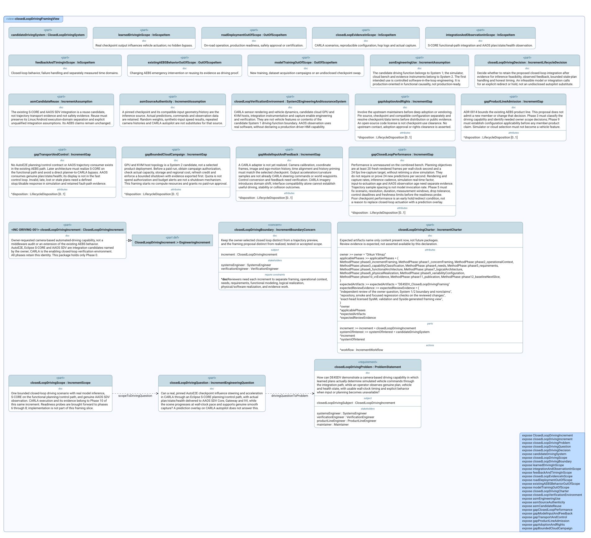

# Driving Views

This index lists every SysML v2 `view` declared in the `.sysml` files of
this first-level model area. Each entry explains the reviewer question in
plain language and embeds the committed diagram SysIDE renders from the
view (`syside viz view`, run by the Privileged Syside Validation workflow).
The SVGs live in [`diagrams/`](diagrams/) beside the model files.

Generated by `scripts/generate_view_index.py` — do not edit by hand.

**1 file, 1 view, 1 published diagram.**

## `closed_loop_driving_framing.sysml`

### `closedLoopDrivingFramingView`

Shows the model elements selected to address the closed loop driving boundary concern.

- **Source:** `closed_loop_driving_framing.sysml`
- **Viewpoint:** `closedLoopDrivingFramingViewpoint` (`IncrementFramingViewpoint`)
- **Concern:** `closedLoopDrivingBoundary`
- **Exposes:** `ClosedLoopDrivingIncrement`, `closedLoopDrivingIncrement`, `closedLoopDrivingProblem`, `closedLoopDrivingQuestion`, `closedLoopDrivingDecision`, `candidateDrivingSystem`, `closedLoopDrivingScope`, `closedLoopDrivingBoundary`, `learnedDrivingInScope`, `integrationAndObservationInScope`, `feedbackAndTimingInScope`, `closedLoopEvidenceInScope`, `roadDeploymentOutOfScope`, `existingAEBSBehaviorOutOfScope`, `modelTrainingOutOfScope`, `closedLoopDrivingCharter`, `closedLoopVerificationEnvironment`, `asmEngineeringUse`, `asmSourceAuthenticity`, `asmCandidateReuse`, `gapClosedLoopPerformance`, `gapModelInputAndFeedback`, `gapTransportAndControl`, `gapProductLineAdmission`, `gapAdoptionAndRights`, `gapBoundedCloudCampaign`
- **Render:** `asTreeDiagram`

- **Diagram status:** Published from the committed SysIDE SVG.
- **Presentation note:** This is a dense review artifact; open the SVG at full size rather than reading it from the page thumbnail.

