# Ee Views

This index lists every SysML v2 `view` declared in the `.sysml` files of
this first-level model area. Each entry explains the reviewer question in
plain language and embeds the committed diagram SysIDE renders from the
view (`syside viz view`, run by the Privileged Syside Validation workflow).
The SVGs live in [`diagrams/`](diagrams/) beside the model files.

Generated by `scripts/generate_view_index.py` — do not edit by hand.

**6 files, 17 views, 17 published diagrams.**

## `ee_architecture_framing.sysml`

### `eeArchitectureFramingView`

Shows the model elements selected to address the ee architecture boundary concern.

- **Source:** `ee_architecture_framing.sysml`
- **Viewpoint:** `eeArchitectureFramingViewpoint` (`IncrementFramingViewpoint`)
- **Concern:** `eeArchitectureBoundary`
- **Exposes:** `EEArchitectureIncrement`, `eeArchitectureIncrement`, `eeArchitectureProblem`, `eeArchitectureQuestion`, `eeArchitectureDecision`, `eeVehicleNetworkSystem`, `eeArchitectureScope`, `eeArchitectureBoundary`, `eeVehicleCommandConcern`, `eeTopologyStructureConcern`, `eeCommandItemConcern`, `eeCommandRouteExchangeConcern`, `eeNetworkFaultResponseConcern`, `eeRouteVerdictConcern`, `eeTopologyInScope`, `eeCommandFlowInScope`, `eeCommandRouteInScope`, `eeNetworkFaultsInScope`, `eeVerdictEvidenceInScope`, `eeTimingOutOfScope`, `eeTrafficShapingOutOfScope`, `eeDiagnosticsUpdateOutOfScope`, `eeSecurityOutOfScope`, `eeRedundancyOutOfScope`, `eeVariabilityOutOfScope`, `eeSensorDataOutOfScope`, `eeClosedLoopOutOfScope`, `eeHardwareEffectsOutOfScope`, `eeSafetyClaimOutOfScope`, `eeArchitectureCharter`, `eeVerificationEnvironment`, `asmEECommandFromDrivingBaseline`, `asmEESoftwareTestbedStandsIn`, `asmEEScoreCommandSource`, `gapEESafetyPathArchitecture`, `gapEEZoneRouteInVehicles`, `gapEEActuationEnd`, `gapEEBrakeHandoff`, `gapEEStackAndNetworkBoundary`, `gapEENetworkInProductLine`, `gapEEBenchPlatform`, `gapEERecordedCommandStream`
- **Render:** `asTreeDiagram`

- **Diagram status:** Published from the committed SysIDE SVG.
- **Presentation note:** This is a dense review artifact; open the SVG at full size rather than reading it from the page thumbnail.

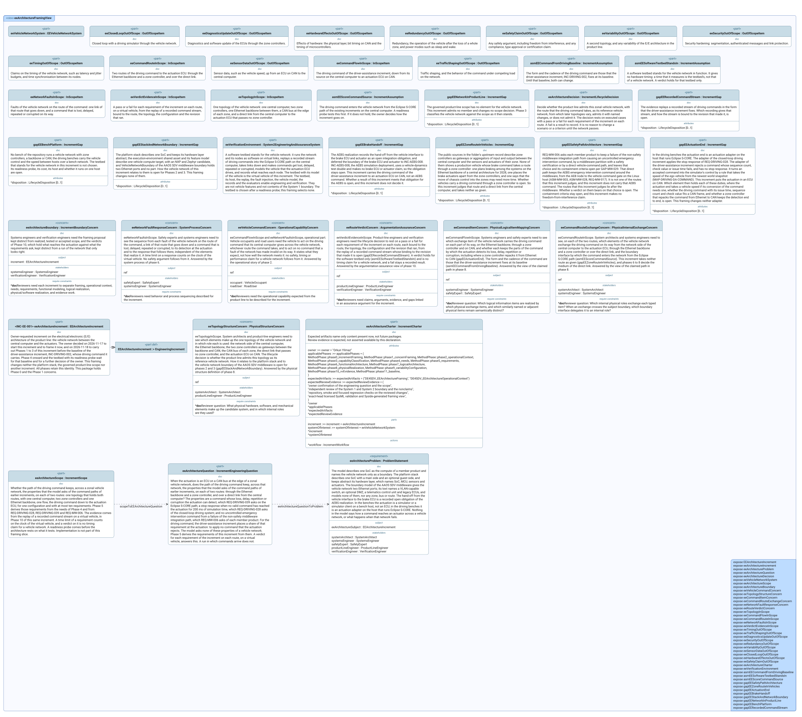

## `ee_architecture_functional_architecture.sysml`

### `eeVehicleNetworkFunctionBreakdownView`

System architects and verification engineers need the functions of the vehicle network and each requirement of phase 5 mapped to the functions that carry it: phase 7 gives the functions to logical elements, and phase 10 verifies each requirement on its functions.

- **Source:** `ee_architecture_functional_architecture.sysml`
- **Viewpoint:** `eeFunctionBreakdownViewpoint` (`SystemFunctionalBreakdownStructureViewpoint`)
- **Concern:** `eeVehicleNetworkFunctionsConcern`
- **Exposes:** `eeVehicleNetworkFunctionalFlow`
- **Render:** `asTreeDiagram`

- **Diagram status:** Published from the committed SysIDE SVG.
- **Presentation note:** SysIDE lists the items and the five functions of `eeVehicleNetworkFunctionalFlow` but does not draw the flows between them. The flows are modeled in the source, in the action definition `EEVehicleNetworkFunctionalFlow`, and the requirements each function carries are in `eeVehicleNetworkRequirementFunctionMatrixView`.

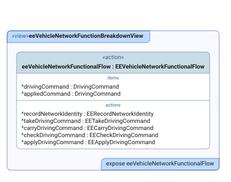

### `eeVehicleNetworkRequirementFunctionMatrixView`

System architects and verification engineers need the functions of the vehicle network and each requirement of phase 5 mapped to the functions that carry it: phase 7 gives the functions to logical elements, and phase 10 verifies each requirement on its functions.

- **Source:** `ee_architecture_functional_architecture.sysml`
- **Viewpoint:** `eeRequirementFunctionViewpoint` (`SystemRequirementTraceabilityViewpoint`)
- **View type:** `MVD::MatrixView`
- **Concern:** `eeVehicleNetworkFunctionsConcern`
- **Exposes:** `reqBothRoutesInOneTopology`, `reqCommandsOnlyFromSCOREPath`, `reqCommandsOnlyOnTheirRoute`, `reqDeliverCommandStreamUnchanged`, `reqCarryEachCommandWithin50Ms`, `reqApplyEachValidCommand`, `reqPassDetectionPartsOnAsTaken`, `reqGiveOnlyLastValidCommand`, `reqStopResponseAfter200Ms`, `reqRecordNetworkIdentity`, `eeVehicleNetworkFunctionalFlow::recordNetworkIdentity`, `eeVehicleNetworkFunctionalFlow::takeDrivingCommand`, `eeVehicleNetworkFunctionalFlow::carryDrivingCommand`, `eeVehicleNetworkFunctionalFlow::checkDrivingCommand`, `eeVehicleNetworkFunctionalFlow::applyDrivingCommand`, `DE4SDV_EEArchitectureFunctionalArchitecture::*`

- **Diagram status:** Published from the committed SysIDE SVG.

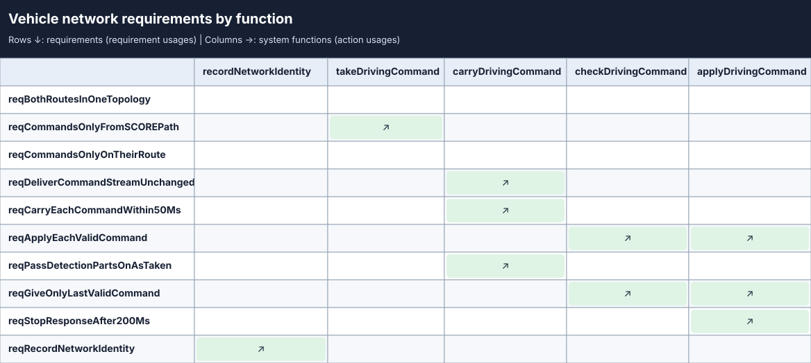

### `eeVehicleNetworkSystemProcessView`

Shows the model elements selected to address the ee network fault response concern.

- **Source:** `ee_architecture_functional_architecture.sysml`
- **Viewpoint:** `eeSystemProcessViewpoint` (`SystemProcessViewpoint`)
- **View type:** `ActionFlowView`
- **Concern:** `eeNetworkFaultResponseConcern`
- **Exposes:** `EEVehicleNetworkSystemProcess::*`, `EEVehicleNetworkSystemProcess::commandSource::*`, `EEVehicleNetworkSystemProcess::scorePath::*`, `EEVehicleNetworkSystemProcess::vehicleNetwork::*`, `EEVehicleNetworkSystemProcess::vehicle::*`

- **Diagram status:** Published from the committed SysIDE SVG.
- **Presentation note:** The diagram draws the four lanes, the action of the vehicle network and the three flows between them. The sequence from a fault to the stop response, and its times, are in the documentation of EEVehicleNetworkSystemProcess, whose rows the diagram hides.

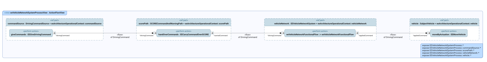

### `eeVehicleNetworkStateTableView`

Safety experts and systems engineers need the states of the actuation ECU in a run, by the valid driving commands that reach it, and the function whose behavior differs in each: before the first valid command, while it applies valid commands, and once more than 200 ms of simulation time pass without a valid driving command, until the run ends.

- **Source:** `ee_architecture_functional_architecture.sysml`
- **Viewpoint:** `eeStateTableViewpoint` (`SystemStateViewpoint`)
- **View type:** `TVD::TableView`
- **Concern:** `eeActuationStatesConcern`
- **Exposes:** `EEActuationStates::noValidCommandYet`, `EEActuationStates::applyingValidCommands`, `EEActuationStates::givingStopResponse`

- **Diagram status:** Published from the committed SysIDE SVG.

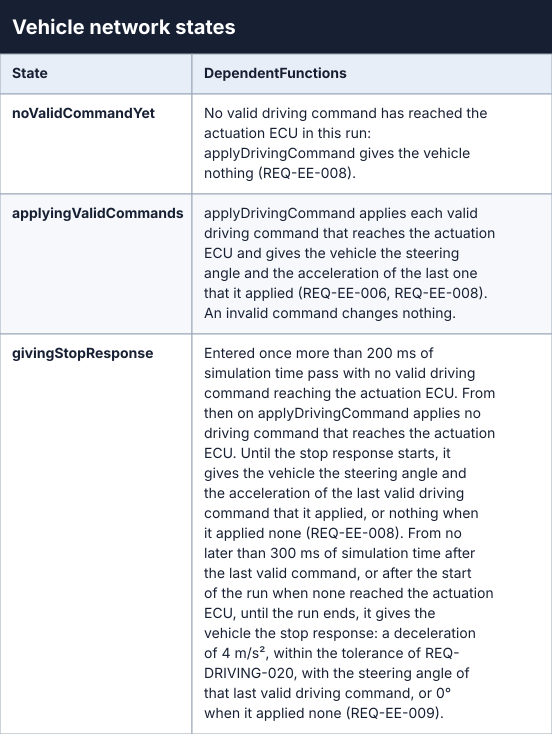

### `eeVehicleNetworkFunctionalInterfaceView`

Systems engineers and software developers need the conceptual interfaces of the vehicle network before phase 7 allocates its functions and phase 8 places elements and software on them: the port at its boundary for each item that crosses it, the direction of that item, and the item that the port's item specializes.

- **Source:** `ee_architecture_functional_architecture.sysml`
- **Viewpoint:** `eeFunctionalInterfaceViewpoint` (`SystemInterfaceDefinitionViewpoint`)
- **Concern:** `eeVehicleNetworkInterfaceConcern`
- **Exposes:** `EEActuationOutbound`, `EEDrivingCommandInbound`
- **Render:** `asTreeDiagram`

- **Diagram status:** Published from the committed SysIDE SVG.

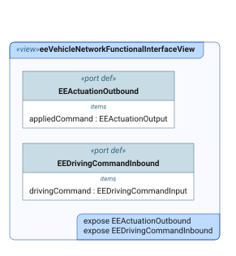

## `ee_architecture_logical_architecture.sysml`

### `eeVehicleNetworkLogicalStructureView`

System architects and software developers need the logical elements of the vehicle network, one level inside its functional boundary, each with the responsibility it carries and its ports, before phase 8 allocates each of them to a physical element: which logical elements there are, and why each stands alone.

- **Source:** `ee_architecture_logical_architecture.sysml`
- **Viewpoint:** `eeLogicalStructureViewpoint` (`SystemStructureDefinitionViewpoint`)
- **Concern:** `eeVehicleNetworkLogicalStructureConcern`
- **Exposes:** `eeVehicleNetworkLogicalSystem`, `eeVehicleNetworkLogicalSystem::eeIdentityRecorder`, `eeVehicleNetworkLogicalSystem::eeCommandCarrier`, `eeVehicleNetworkLogicalSystem::eeActuationEnd`
- **Render:** `asTreeDiagram`

- **Diagram status:** Published from the committed SysIDE SVG.

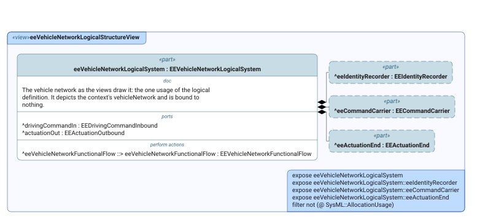

### `eeVehicleNetworkFunctionMappingView`

System architects and verification engineers need each function of phase 6 allocated to the logical element that carries it, and each logical element carrying a function: phase 8 allocates each logical element to a physical element, and phase 10 verifies the requirements that their functions carry.

- **Source:** `ee_architecture_logical_architecture.sysml`
- **Viewpoint:** `eeFunctionMappingViewpoint` (`SystemFunctionMappingViewpoint`)
- **View type:** `MVD::MatrixView`
- **Concern:** `eeVehicleNetworkFunctionMappingConcern`
- **Exposes:** `eeVehicleNetworkFunctionalFlow::recordNetworkIdentity`, `eeVehicleNetworkFunctionalFlow::takeDrivingCommand`, `eeVehicleNetworkFunctionalFlow::carryDrivingCommand`, `eeVehicleNetworkFunctionalFlow::checkDrivingCommand`, `eeVehicleNetworkFunctionalFlow::applyDrivingCommand`, `EEVehicleNetworkLogicalSystem::eeIdentityRecorder`, `EEVehicleNetworkLogicalSystem::eeCommandCarrier`, `EEVehicleNetworkLogicalSystem::eeActuationEnd`, `DE4SDV_EEArchitectureLogicalArchitecture::*`

- **Diagram status:** Published from the committed SysIDE SVG.

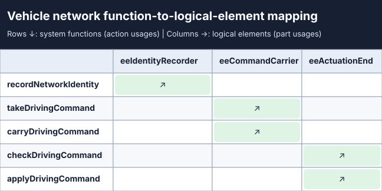

### `eeVehicleNetworkInternalExchangeView`

Systems engineers and software developers need the exchanges of the vehicle network between its logical elements, the item each carries and its direction: the carried driving commands, the one exchange between logical elements, which REQ-EE-004, REQ-EE-005 and REQ-EE-007 constrain and whose lack of a valid driving command for more than 200 ms of simulation time starts the stop response of REQ-EE-009; and the boundary items delegated to the logical element that takes or provides them, the driving command by the one input that REQ-EE-002 keeps.

- **Source:** `ee_architecture_logical_architecture.sysml`
- **Viewpoint:** `eeInternalExchangeViewpoint` (`SystemInternalExchangeViewpoint`)
- **Concern:** `eeVehicleNetworkInternalExchangeConcern`
- **Exposes:** `eeVehicleNetworkLogicalSystem`, `eeVehicleNetworkLogicalSystem::**`
- **Depth:** `-1`
- **Render:** `asInterconnectionDiagram`

- **Diagram status:** Published from the committed SysIDE SVG.

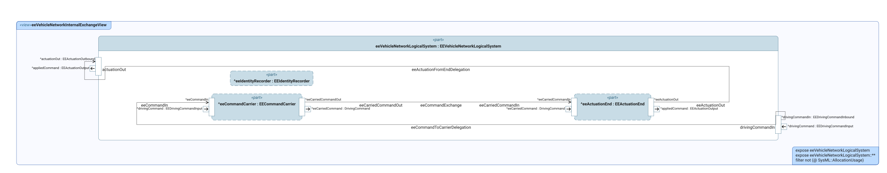

## `ee_architecture_needs_requirements.sysml`

### `eeArchitectureNeedsView`

Systems engineers and product-line engineers need the stakeholder needs of the vehicle network with their statements and sources, and the planned stakeholder review of each, to judge whether the needs cover the concerns of phase 1.

- **Source:** `ee_architecture_needs_requirements.sysml`
- **Viewpoint:** `selectedNeedsViewpoint` (`StakeholderRequirementDefinitionViewpoint`)
- **View type:** `TVD::TableView`
- **Concern:** `eeArchitectureNeedsConcern`
- **Exposes:** `needDrivingCommandReachesActuationOnEachRoute`, `needNoInvalidCommandApplied`, `needRunsIdentifyRouteAndNetwork`

- **Diagram status:** Published from the committed SysIDE SVG.

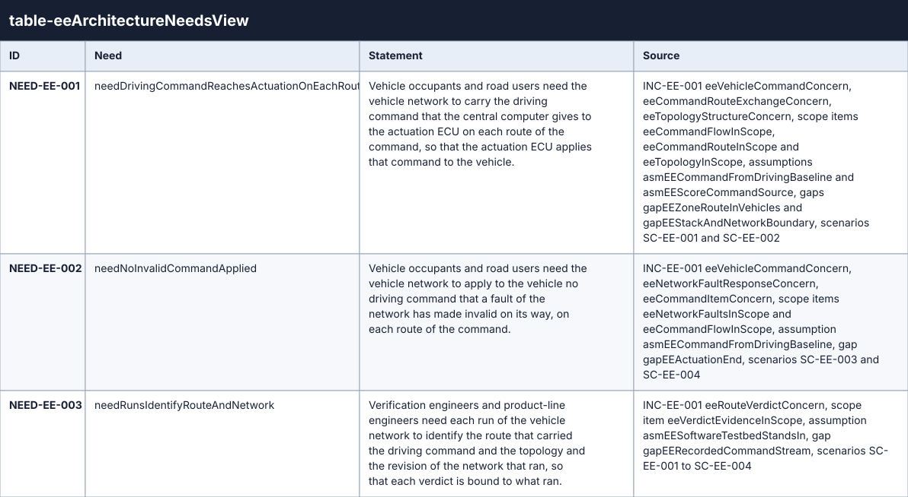

### `eeArchitectureNeedValidationView`

Systems engineers and product-line engineers need the stakeholder needs of the vehicle network with their statements and sources, and the planned stakeholder review of each, to judge whether the needs cover the concerns of phase 1.

- **Source:** `ee_architecture_needs_requirements.sysml`
- **Viewpoint:** `selectedNeedValidationViewpoint` (`StakeholderRequirementDefinitionViewpoint`)
- **View type:** `TVD::TableView`
- **Concern:** `eeArchitectureNeedsConcern`
- **Exposes:** `commandOnEachRouteValidationPlan`, `networkFaultValidationPlan`, `runIdentityValidationPlan`

- **Diagram status:** Published from the committed SysIDE SVG.

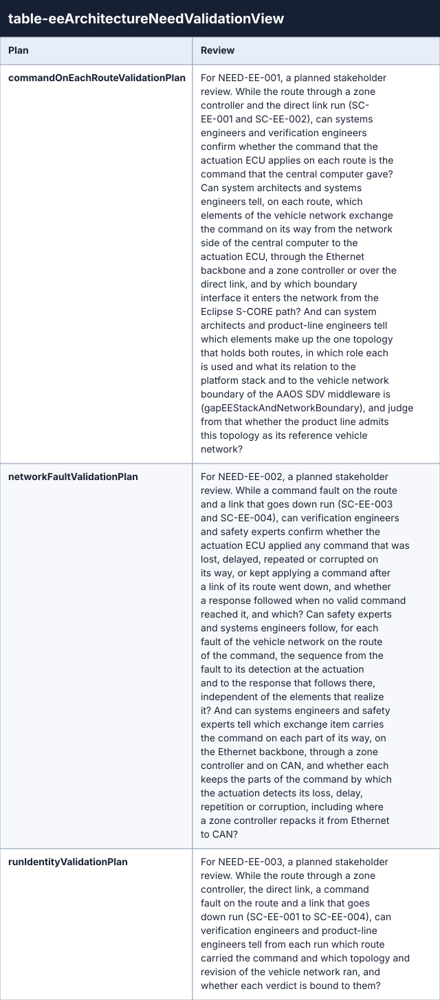

### `eeArchitectureRequirementsView`

Verification engineers and open-source reviewers need each requirement of the vehicle network traced to the need it derives from, with its source, its rationale, its verification method and its success criteria, to judge whether the requirements answer the needs and can be verified.

- **Source:** `ee_architecture_needs_requirements.sysml`
- **Viewpoint:** `selectedRequirementDefinitionViewpoint` (`SystemRequirementDefinitionViewpoint`)
- **View type:** `TVD::TableView`
- **Concern:** `eeArchitectureRequirementTraceConcern`
- **Exposes:** `reqBothRoutesInOneTopology`, `reqCommandsOnlyFromSCOREPath`, `reqCommandsOnlyOnTheirRoute`, `reqDeliverCommandStreamUnchanged`, `reqCarryEachCommandWithin50Ms`, `reqApplyEachValidCommand`, `reqPassDetectionPartsOnAsTaken`, `reqGiveOnlyLastValidCommand`, `reqStopResponseAfter200Ms`, `reqRecordNetworkIdentity`

- **Diagram status:** Published from the committed SysIDE SVG.

## `ee_architecture_operational_context.sysml`

### `eeArchitectureOperationalContextView`

System architects, systems engineers and open-source reviewers need to see what is inside the vehicle network and what is around it: the source of the driving command, the Eclipse S-CORE path and the vehicle, and which item crosses the boundary in which direction.

- **Source:** `ee_architecture_operational_context.sysml`
- **Viewpoint:** `eeArchitectureContextViewpoint` (`OperationalContextDefinitionViewpoint`)
- **Concern:** `eeArchitectureContextConcern`
- **Exposes:** `eeArchitectureOperationalContext`, `eeArchitectureOperationalContext::*`, `vehicleNetworkCommandOperation`
- **Depth:** `2`
- **Render:** `asTreeDiagram`

- **Diagram status:** Published from the committed SysIDE SVG.

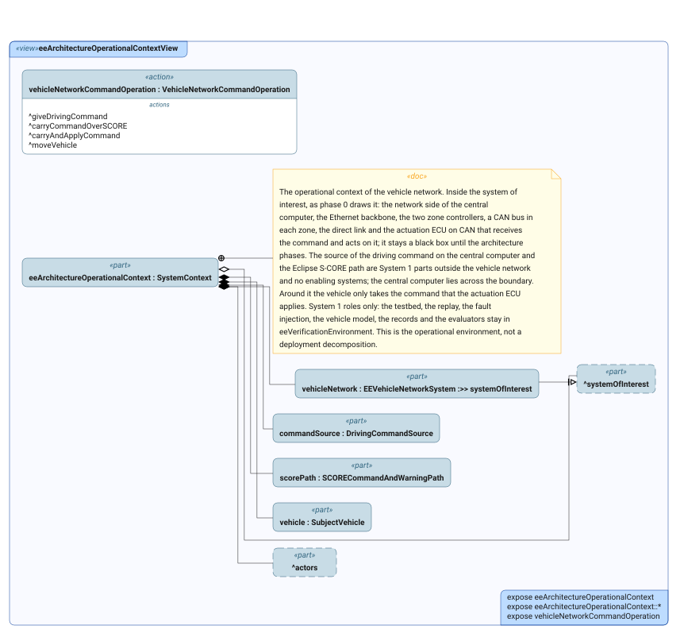

### `eeArchitectureOperationalStoryView`

Systems engineers, verification engineers and open-source reviewers need the vehicle network told in stakeholder language: the driving command on each of its two routes, a command that a fault makes invalid, and a link of the route that goes down.

- **Source:** `ee_architecture_operational_context.sysml`
- **Viewpoint:** `eeArchitectureStoryViewpoint` (`OperationalStoryViewpoint`)
- **Concern:** `eeArchitectureStoryConcern`
- **Exposes:** `vehicleNetworkStory`, `vehicleNetworkStory::*`
- **Depth:** `1`
- **Render:** `asTreeDiagram`

- **Diagram status:** Published from the committed SysIDE SVG.

## `ee_architecture_physical_ee_realization.sysml`

### `eeVehicleNetworkPhysicalStructureView`

Shows the model elements selected to address the ee topology structure concern.

- **Source:** `ee_architecture_physical_ee_realization.sysml`
- **Viewpoint:** `eePhysicalStructureViewpoint` (`PhysicalStructureDefinitionViewpoint`)
- **Concern:** `eeTopologyStructureConcern`
- **Exposes:** `eeVehicleNetworkPhysicalSystem`, `eeVehicleNetworkPhysicalSystem::eeCentralComputer`, `eeVehicleNetworkPhysicalSystem::eeCentralComputer::eeNetworkSide`, `eeVehicleNetworkPhysicalSystem::eeEthernetBackbone`, `eeVehicleNetworkPhysicalSystem::eeActuationZoneController`, `eeVehicleNetworkPhysicalSystem::eeOtherZoneController`, `eeVehicleNetworkPhysicalSystem::eeActuationZoneCANFDBus`, `eeVehicleNetworkPhysicalSystem::eeOtherZoneCANFDBus`, `eeVehicleNetworkPhysicalSystem::eeDirectCANFDLink`, `eeVehicleNetworkPhysicalSystem::eeActuationECU`, `eeVehicleNetworkPhysicalSystem::eeActuatedVehicle`
- **Render:** `asTreeDiagram`

- **Diagram status:** Published from the committed SysIDE SVG.

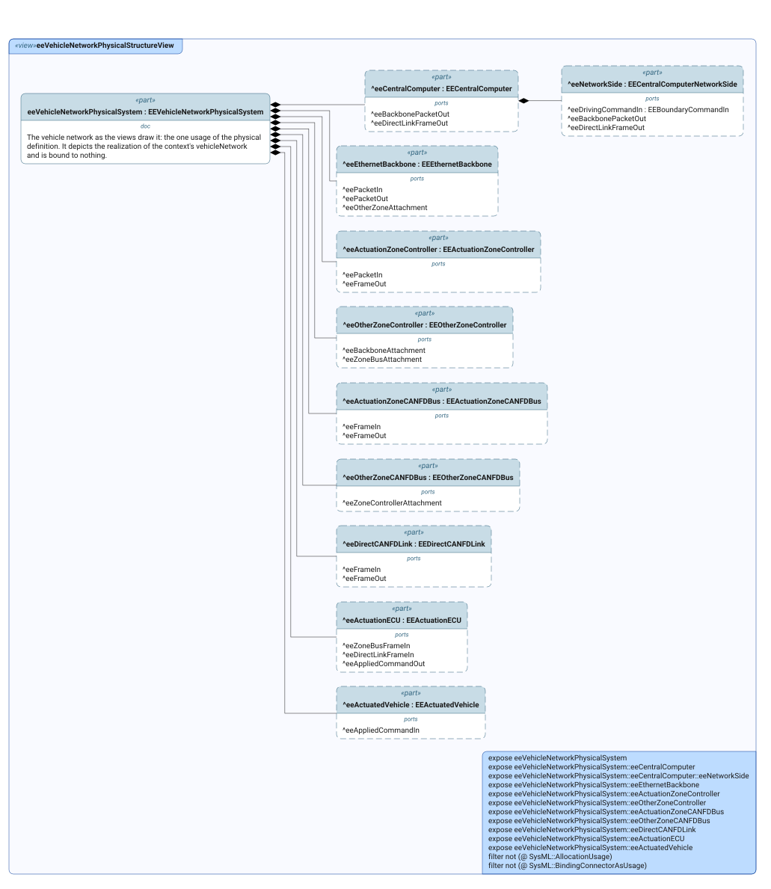

### `eeVehicleNetworkPhysicalLogicalMappingView`

System architects and verification engineers need each logical element of phase 7 allocated to the nodes of the vehicle network that carry it, and each node that carries one: the network side of the central computer, which carries the identity recorder and the command carrier, the zone controller of the actuation ECU's zone, which carries the command carrier, and the actuation ECU, which carries the actuation end.

- **Source:** `ee_architecture_physical_ee_realization.sysml`
- **Viewpoint:** `eePhysicalLogicalMappingViewpoint` (`PhysicalLogicalMappingViewpoint`)
- **View type:** `MVD::MatrixView`
- **Concern:** `eeVehicleNetworkPhysicalAllocationConcern`
- **Exposes:** `EEVehicleNetworkLogicalSystem::eeIdentityRecorder`, `EEVehicleNetworkLogicalSystem::eeCommandCarrier`, `EEVehicleNetworkLogicalSystem::eeActuationEnd`, `eeVehicleNetworkPhysicalSystem::eeCentralComputer::eeNetworkSide`, `eeVehicleNetworkPhysicalSystem::eeActuationZoneController`, `eeVehicleNetworkPhysicalSystem::eeActuationECU`, `DE4SDV_EEArchitecturePhysicalEERealization::*`

- **Diagram status:** Published from the committed SysIDE SVG.

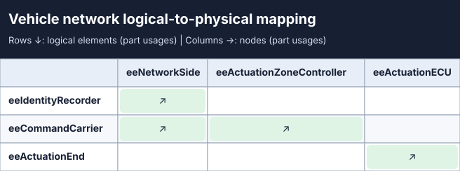

### `eeVehicleNetworkRouteExchangeView`

Shows the model elements selected to address the ee command route exchange concern.

- **Source:** `ee_architecture_physical_ee_realization.sysml`
- **Viewpoint:** `eeRouteExchangeViewpoint` (`PhysicalInternalExchangeViewpoint`)
- **Concern:** `eeCommandRouteExchangeConcern`
- **Exposes:** `eeVehicleNetworkPhysicalSystem`, `eeVehicleNetworkPhysicalSystem::eeCentralComputer`, `eeVehicleNetworkPhysicalSystem::eeCentralComputer::eeBackbonePacketOut`, `eeVehicleNetworkPhysicalSystem::eeCentralComputer::eeDirectLinkFrameOut`, `eeVehicleNetworkPhysicalSystem::eeCentralComputer::eeNetworkSide`, `eeVehicleNetworkPhysicalSystem::eeCentralComputer::eeNetworkSide::eeDrivingCommandIn`, `eeVehicleNetworkPhysicalSystem::eeCentralComputer::eeNetworkSide::eeBackbonePacketOut`, `eeVehicleNetworkPhysicalSystem::eeCentralComputer::eeNetworkSide::eeDirectLinkFrameOut`, `eeVehicleNetworkPhysicalSystem::eeEthernetBackbone`, `eeVehicleNetworkPhysicalSystem::eeEthernetBackbone::eePacketIn`, `eeVehicleNetworkPhysicalSystem::eeEthernetBackbone::eePacketOut`, `eeVehicleNetworkPhysicalSystem::eeEthernetBackbone::eeOtherZoneAttachment`, `eeVehicleNetworkPhysicalSystem::eeActuationZoneController`, `eeVehicleNetworkPhysicalSystem::eeActuationZoneController::eePacketIn`, `eeVehicleNetworkPhysicalSystem::eeActuationZoneController::eeFrameOut`, `eeVehicleNetworkPhysicalSystem::eeOtherZoneController`, `eeVehicleNetworkPhysicalSystem::eeOtherZoneController::eeBackboneAttachment`, `eeVehicleNetworkPhysicalSystem::eeOtherZoneController::eeZoneBusAttachment`, `eeVehicleNetworkPhysicalSystem::eeActuationZoneCANFDBus`, `eeVehicleNetworkPhysicalSystem::eeActuationZoneCANFDBus::eeFrameIn`, `eeVehicleNetworkPhysicalSystem::eeActuationZoneCANFDBus::eeFrameOut`, `eeVehicleNetworkPhysicalSystem::eeOtherZoneCANFDBus`, `eeVehicleNetworkPhysicalSystem::eeOtherZoneCANFDBus::eeZoneControllerAttachment`, `eeVehicleNetworkPhysicalSystem::eeDirectCANFDLink`, `eeVehicleNetworkPhysicalSystem::eeDirectCANFDLink::eeFrameIn`, `eeVehicleNetworkPhysicalSystem::eeDirectCANFDLink::eeFrameOut`, `eeVehicleNetworkPhysicalSystem::eeActuationECU`, `eeVehicleNetworkPhysicalSystem::eeActuationECU::eeZoneBusFrameIn`, `eeVehicleNetworkPhysicalSystem::eeActuationECU::eeDirectLinkFrameIn`, `eeVehicleNetworkPhysicalSystem::eeActuationECU::eeAppliedCommandOut`, `eeVehicleNetworkPhysicalSystem::eeActuatedVehicle`, `eeVehicleNetworkPhysicalSystem::eeActuatedVehicle::eeAppliedCommandIn`, `eeVehicleNetworkPhysicalSystem::eeBackbonePacketFromCentralComputer`, `eeVehicleNetworkPhysicalSystem::eeBackbonePacketToActuationZone`, `eeVehicleNetworkPhysicalSystem::eeZoneBusFrameFromZoneController`, `eeVehicleNetworkPhysicalSystem::eeZoneBusFrameToActuationECU`, `eeVehicleNetworkPhysicalSystem::eeDirectLinkFrameFromCentralComputer`, `eeVehicleNetworkPhysicalSystem::eeDirectLinkFrameToActuationECU`, `eeVehicleNetworkPhysicalSystem::eeAppliedCommandToVehicle`, `eeVehicleNetworkPhysicalSystem::eeOtherZoneOnBackbone`, `eeVehicleNetworkPhysicalSystem::eeOtherZoneBusOnZoneController`
- **Depth:** `-1`
- **Render:** `asInterconnectionDiagram`

- **Diagram status:** Published from the committed SysIDE SVG.

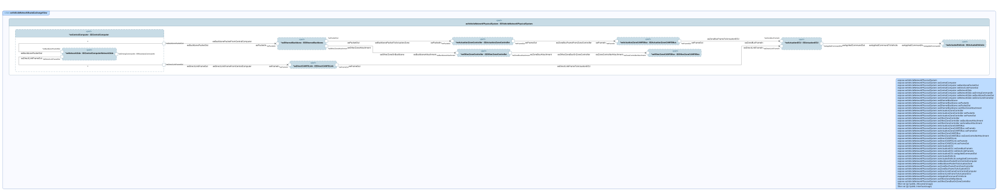
