# Hmi Views

This index lists every SysML v2 `view` declared in the `.sysml` files of
this first-level model area. Each entry explains the reviewer question in
plain language and embeds the committed diagram SysIDE renders from the
view (`syside viz view`, run by the Privileged Syside Validation workflow).
The SVGs live in [`diagrams/`](diagrams/) beside the model files.

Generated by `scripts/generate_view_index.py` — do not edit by hand.

**6 files, 17 views, 14 published diagrams.**

## `hmi_display_framing.sysml`

### `hmiDisplayFramingView`

Shows the model elements selected to address the hmi display boundary concern.

- **Source:** `hmi_display_framing.sysml`
- **Viewpoint:** `hmiDisplayFramingViewpoint` (`IncrementFramingViewpoint`)
- **Concern:** `hmiDisplayBoundary`
- **Exposes:** `HmiDisplayIncrement`, `hmiDisplayIncrement`, `hmiDisplayProblem`, `hmiDisplayQuestion`, `hmiDisplayDecision`, `hmiDisplaySystem`, `hmiDisplayScope`, `hmiDisplayBoundary`, `hmiDriverSupervisionConcern`, `hmiDisplayInputsConcern`, `hmiContentVarianceConcern`, `hmiWarningSequenceConcern`, `hmiContentCurrencyConcern`, `hmiAndroidOutageConcern`, `hmiRendererAllocationConcern`, `hmiRendererPathConcern`, `hmiDisplayVerdictConcern`, `hmiSceneInScope`, `hmiSpeedInScope`, `hmiCollisionWarningInScope`, `hmiRendererSplitInScope`, `hmiAndroidOutageInScope`, `hmiStaleContentInScope`, `hmiVerdictEvidenceInScope`, `hmiSimulatorTruthOutOfScope`, `hmiPerceptionQualityOutOfScope`, `hmiOtherDrivingApplicationsOutOfScope`, `hmiDriverInteractionOutOfScope`, `hmiFurtherContentOutOfScope`, `hmiHumanFactorsOutOfScope`, `hmiCandidateChangeOutOfScope`, `hmiStandaloneDisplayOutOfScope`, `hmiOnRoadOperationOutOfScope`, `hmiDisplayCharter`, `hmiDisplayVerificationEnvironment`, `asmHmiDrivingBenchReuse`, `asmHmiRendererWithoutGraphicsCard`, `asmHmiSimulationStandsIn`, `gapHmiSceneOutput`, `gapHmiSceneContent`, `gapHmiRendererCollisionWarning`, `gapHmiRendererIntegration`, `gapHmiWarningPresentation`, `gapHmiWarningAvailability`, `gapHmiMemberGuestLayout`, `gapHmiStandaloneLinuxDisplay`, `gapHmiAAOSIntegratedGuestDisplay`, `gapHmiDisplayInProductLine`, `gapHmiUpstreamContact`
- **Render:** `asTreeDiagram`

- **Diagram status:** Published from the committed SysIDE SVG.
- **Presentation note:** This is a dense review artifact; open the SVG at full size rather than reading it from the page thumbnail.

## `hmi_display_functional_architecture.sysml`

### `hmiDisplayFunctionBreakdownView`

System architects and verification engineers need the functions of the HMI display and each requirement of phase 5 mapped to the functions that carry it: phase 7 gives the functions to logical elements, and phase 10 verifies each requirement on its functions.

- **Source:** `hmi_display_functional_architecture.sysml`
- **Viewpoint:** `selectedFunctionalBreakdownViewpoint` (`SystemFunctionalBreakdownStructureViewpoint`)
- **Concern:** `hmiDisplayFunctionsConcern`
- **Exposes:** `hmiDisplayFunctionalFlow`
- **Render:** `asTreeDiagram`

- **Diagram status:** Published from the committed SysIDE SVG.
- **Presentation note:** SysIDE lists the items and the five functions of `hmiDisplayFunctionalFlow` but does not draw the flows between them. The flows are modeled in the source, in the action definition `HmiDisplayFunctionalFlow`, and the requirements each function carries are in `hmiDisplayRequirementFunctionMatrixView`.

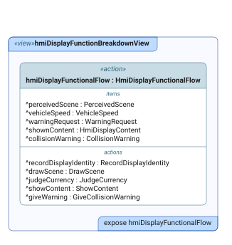

### `hmiDisplayRequirementFunctionMatrixView`

System architects and verification engineers need the functions of the HMI display and each requirement of phase 5 mapped to the functions that carry it: phase 7 gives the functions to logical elements, and phase 10 verifies each requirement on its functions.

- **Source:** `hmi_display_functional_architecture.sysml`
- **Viewpoint:** `selectedRequirementFunctionViewpoint` (`SystemRequirementTraceabilityViewpoint`)
- **View type:** `MVD::MatrixView`
- **Concern:** `hmiDisplayFunctionsConcern`
- **Exposes:** `reqShowTheSceneAsGiven`, `reqMarkTheObjectTheSystemActsOn`, `reqShowTheVehicleSpeed`, `reqCollisionWarningWhileRequested`, `reqStartEachWarningModeWithinLimit`, `reqShowOutdatedElementsAsOutdated`, `reqShowWarningUnavailableWhileRequestOutdated`, `reqSpeedAndWarningThroughOutages`, `reqRendererSplitAndInputPaths`, `reqRecordDisplayIdentity`, `hmiDisplayFunctionalFlow::recordDisplayIdentity`, `hmiDisplayFunctionalFlow::drawScene`, `hmiDisplayFunctionalFlow::judgeCurrency`, `hmiDisplayFunctionalFlow::showContent`, `hmiDisplayFunctionalFlow::giveWarning`, `DE4SDV_HmiDisplayFunctionalArchitecture::*`

- **Diagram status:** Published from the committed SysIDE SVG.

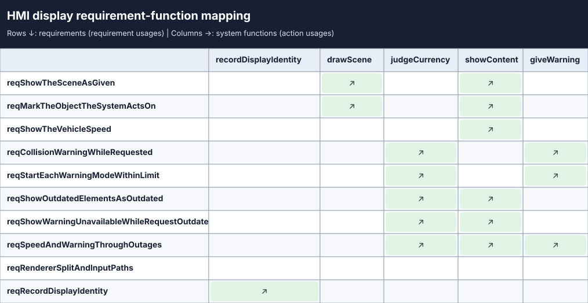

### `hmiDisplaySystemProcessView`

Shows the model elements selected to address the hmi display inputs concern.

- **Source:** `hmi_display_functional_architecture.sysml`
- **Viewpoint:** `selectedSystemProcessViewpoint` (`SystemProcessViewpoint`)
- **View type:** `ActionFlowView`
- **Concern:** `hmiDisplayInputsConcern`
- **Exposes:** `HmiDisplaySystemProcess::*`, `HmiDisplaySystemProcess::candidate::*`, `HmiDisplaySystemProcess::scorePath::*`, `HmiDisplaySystemProcess::vehicle::*`, `HmiDisplaySystemProcess::hmiDisplay::*`, `HmiDisplaySystemProcess::driver::*`

- **Diagram status:** Published from the committed SysIDE SVG.
- **Presentation note:** SysIDE draws the lanes of the process and the flows between them but prints no doc in this form: the times of the warning sequence and the sequence of an outage are in the docs of `HmiDisplaySystemProcess` and of its lanes.

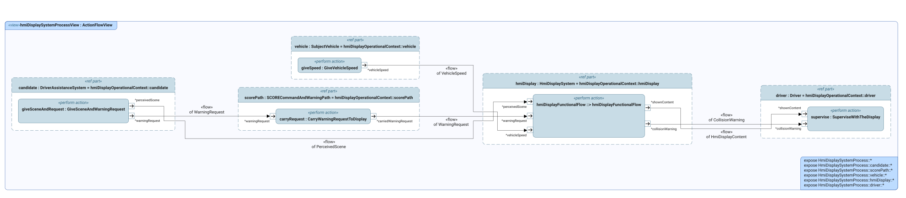

### `hmiDisplayStateTableView`

Shows the model elements selected to address the hmi content currency concern.

- **Source:** `hmi_display_functional_architecture.sysml`
- **Viewpoint:** `selectedSystemStateTableViewpoint` (`SystemStateViewpoint`)
- **View type:** `TVD::TableView`
- **Concern:** `hmiContentCurrencyConcern`
- **Exposes:** `ElementCurrency::outdated`, `ElementCurrency::current`, `CollisionWarningStates::unavailable`, `CollisionWarningStates::notAsking`, `CollisionWarningStates::asking`

- **Diagram status:** Published from the committed SysIDE SVG.

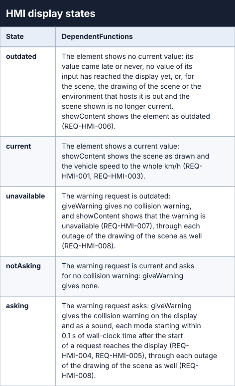

### `hmiDisplayFunctionalInterfaceView`

Systems engineers and software developers need the conceptual interfaces of the HMI display before phase 7 allocates the functions and phase 8 places software on them: the port of the functional chain for each item that crosses its boundary, and the direction of that item.

- **Source:** `hmi_display_functional_architecture.sysml`
- **Viewpoint:** `selectedFunctionalInterfaceViewpoint` (`SystemInterfaceDefinitionViewpoint`)
- **Concern:** `hmiDisplayInterfaceConcern`
- **Exposes:** `DisplayContentOutbound`, `DisplaySceneInbound`, `DisplaySpeedInbound`, `DisplayWarningOutbound`, `DisplayWarningRequestInbound`
- **Render:** `asTreeDiagram`

- **Diagram status:** Published from the committed SysIDE SVG.

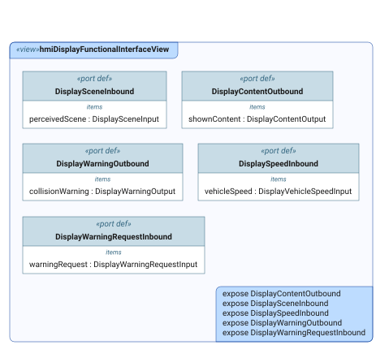

## `hmi_display_logical_architecture.sysml`

### `hmiDisplayLogicalStructureView`

System architects and software developers need the logical elements of the HMI display, one level inside its functional boundary, each with the responsibility it carries and its ports, before phase 8 places software on them: which elements there are, and why each stands alone.

- **Source:** `hmi_display_logical_architecture.sysml`
- **Viewpoint:** `selectedLogicalStructureViewpoint` (`SystemStructureDefinitionViewpoint`)
- **Concern:** `hmiDisplayLogicalStructureConcern`
- **Exposes:** `hmiDisplayLogicalSystem`, `hmiDisplayLogicalSystem::displayIdentityRecorder`, `hmiDisplayLogicalSystem::sceneDrawer`, `hmiDisplayLogicalSystem::displayPresenter`
- **Render:** `asTreeDiagram`

- **Diagram status:** Published from the committed SysIDE SVG.

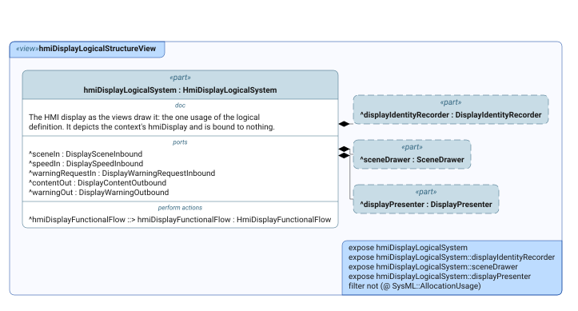

### `hmiDisplayFunctionMappingView`

System architects and verification engineers need each function of phase 6 allocated to the logical element that carries it, and each element carrying a function: phase 8 places the elements, and phase 10 verifies each requirement on the functions of its element.

- **Source:** `hmi_display_logical_architecture.sysml`
- **Viewpoint:** `selectedFunctionMappingViewpoint` (`SystemFunctionMappingViewpoint`)
- **View type:** `MVD::MatrixView`
- **Concern:** `hmiDisplayFunctionMappingConcern`
- **Exposes:** `hmiDisplayFunctionalFlow::recordDisplayIdentity`, `hmiDisplayFunctionalFlow::drawScene`, `hmiDisplayFunctionalFlow::judgeCurrency`, `hmiDisplayFunctionalFlow::showContent`, `hmiDisplayFunctionalFlow::giveWarning`, `HmiDisplayLogicalSystem::displayIdentityRecorder`, `HmiDisplayLogicalSystem::sceneDrawer`, `HmiDisplayLogicalSystem::displayPresenter`, `DE4SDV_HmiDisplayLogicalArchitecture::*`

- **Diagram status:** Published from the committed SysIDE SVG.

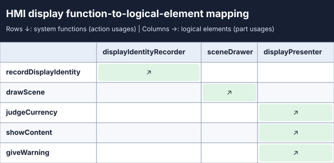

### `hmiDisplayInternalExchangeView`

Systems engineers and software developers need the exchanges between the logical elements of the HMI display, the item each carries and its direction: the drawn scenes, the one exchange between elements, which carries REQ-HMI-001 and REQ-HMI-002 across two elements and whose stop leaves the vehicle speed and the warning going (REQ-HMI-008); and the boundary items delegated to the elements that take or provide them, on paths that REQ-HMI-009 keeps inside the boundary.

- **Source:** `hmi_display_logical_architecture.sysml`
- **Viewpoint:** `selectedInternalExchangeViewpoint` (`SystemInternalExchangeViewpoint`)
- **Concern:** `hmiDisplayInternalExchangeConcern`
- **Exposes:** `hmiDisplayLogicalSystem`, `hmiDisplayLogicalSystem::**`
- **Depth:** `-1`
- **Render:** `asInterconnectionDiagram`

- **Diagram status:** Published from the committed SysIDE SVG.

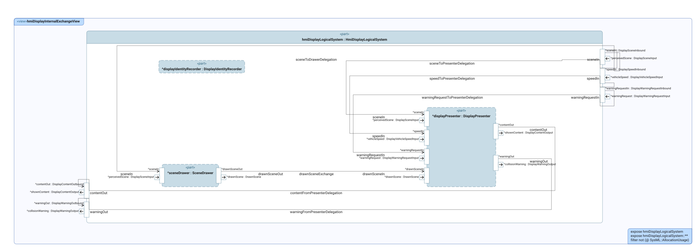

## `hmi_display_needs_requirements.sysml`

### `hmiDisplayNeedsView`

Systems engineers and product-line engineers need the stakeholder needs of the HMI display with their statements and sources, and the planned stakeholder review of each, to judge whether the needs cover the concerns of phase 1.

- **Source:** `hmi_display_needs_requirements.sysml`
- **Viewpoint:** `selectedNeedsViewpoint` (`StakeholderRequirementDefinitionViewpoint`)
- **View type:** `TVD::TableView`
- **Concern:** `hmiDisplayNeedsConcern`
- **Exposes:** `needPerceivedSceneOnTheDisplay`, `needVehicleSpeedOnTheDisplay`, `needCollisionWarningOnRequest`, `needSpeedAndWarningThroughOutages`, `needNoElementShownAsCurrentWhenItIsNot`, `needRunsIdentifyTheDisplay`

- **Diagram status:** Published from the committed SysIDE SVG.

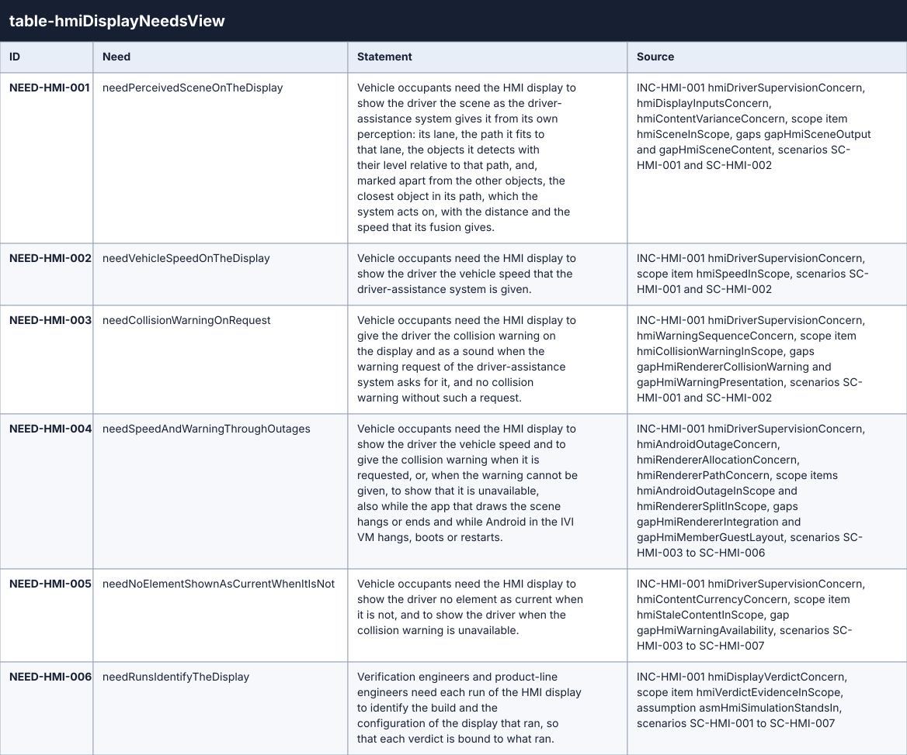

### `hmiDisplayNeedValidationView`

Systems engineers and product-line engineers need the stakeholder needs of the HMI display with their statements and sources, and the planned stakeholder review of each, to judge whether the needs cover the concerns of phase 1.

- **Source:** `hmi_display_needs_requirements.sysml`
- **Viewpoint:** `selectedNeedValidationViewpoint` (`StakeholderRequirementDefinitionViewpoint`)
- **View type:** `TVD::TableView`
- **Concern:** `hmiDisplayNeedsConcern`
- **Exposes:** `hmiSceneValidationPlan`, `hmiSpeedValidationPlan`, `hmiWarningValidationPlan`, `hmiOutageValidationPlan`, `hmiCurrencyValidationPlan`, `hmiDisplayIdentityValidationPlan`

- **Diagram status:** Published from the committed SysIDE SVG.

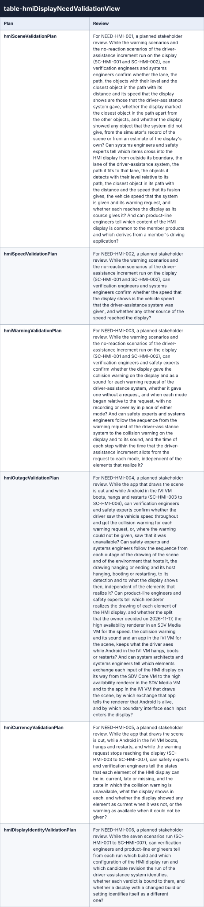

### `hmiDisplayRequirementsView`

Verification engineers and open-source reviewers need each requirement of the HMI display traced to the need it derives from, with its source, its rationale, its verification method and its success criteria, to judge whether the requirements answer the needs and can be verified.

- **Source:** `hmi_display_needs_requirements.sysml`
- **Viewpoint:** `selectedHmiRequirementDefinitionViewpoint` (`SystemRequirementDefinitionViewpoint`)
- **View type:** `TVD::TableView`
- **Concern:** `hmiDisplayRequirementTraceConcern`
- **Exposes:** `reqShowTheSceneAsGiven`, `reqMarkTheObjectTheSystemActsOn`, `reqShowTheVehicleSpeed`, `reqCollisionWarningWhileRequested`, `reqStartEachWarningModeWithinLimit`, `reqShowOutdatedElementsAsOutdated`, `reqShowWarningUnavailableWhileRequestOutdated`, `reqSpeedAndWarningThroughOutages`, `reqRendererSplitAndInputPaths`, `reqRecordDisplayIdentity`

- **Diagram status:** Published from the committed SysIDE SVG.

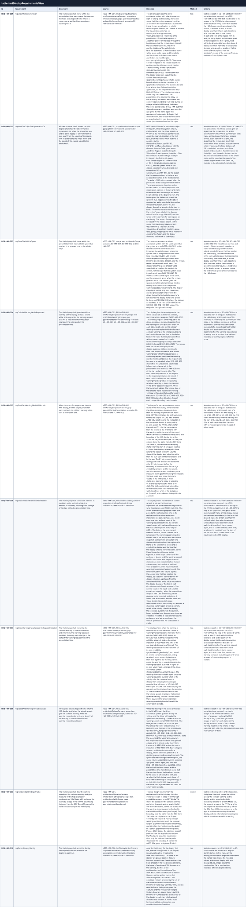

## `hmi_display_operational_context.sysml`

### `hmiDisplayOperationalContextView`

System architects, systems engineers and open-source reviewers need to see what is inside the HMI display and what is around it: the candidate application, the Eclipse S-CORE path, the vehicle and the driver, and which item crosses the boundary in which direction.

- **Source:** `hmi_display_operational_context.sysml`
- **Viewpoint:** `hmiDisplayContextViewpoint` (`OperationalContextDefinitionViewpoint`)
- **Concern:** `hmiDisplayContextConcern`
- **Exposes:** `hmiDisplayOperationalContext`, `hmiDisplayOperationalContext::*`, `hmiDisplayOperation`
- **Depth:** `2`
- **Render:** `asTreeDiagram`

- **Diagram status:** Published from the committed SysIDE SVG.

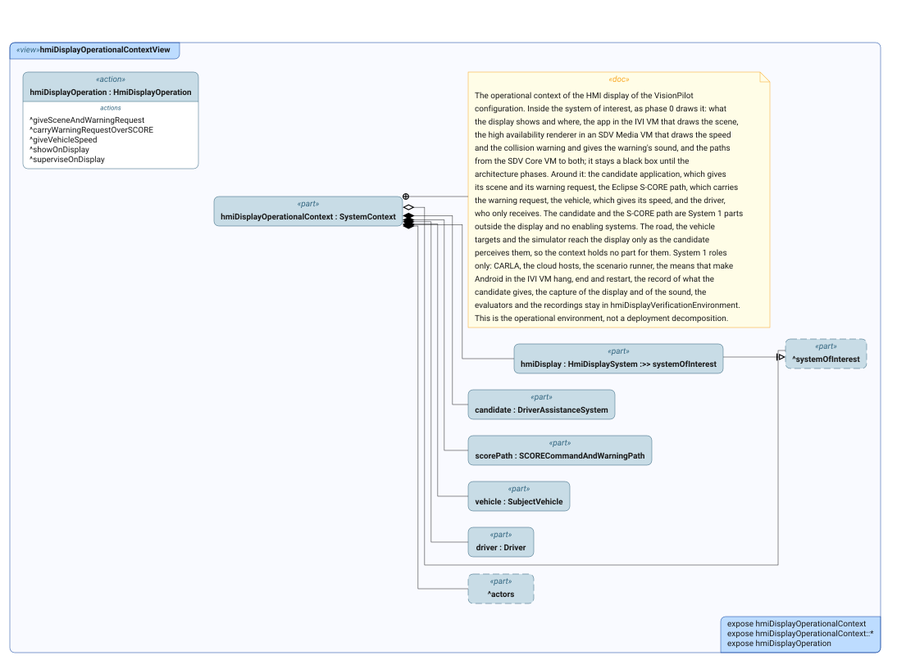

### `hmiDisplayOperationalStoryView`

Systems engineers, verification engineers and open-source reviewers need the HMI display told in stakeholder language: what the driver sees in the scenarios of the driver-assistance increment, with and without a warning, while the app that draws the scene or Android in the IVI VM is out, and while the warning request stops reaching the display.

- **Source:** `hmi_display_operational_context.sysml`
- **Viewpoint:** `hmiDisplayStoryViewpoint` (`OperationalStoryViewpoint`)
- **Concern:** `hmiDisplayStoryConcern`
- **Exposes:** `hmiDisplayStory`, `hmiDisplayStory::*`
- **Depth:** `1`
- **Render:** `asTreeDiagram`

- **Diagram status:** Published from the committed SysIDE SVG.

## `hmi_display_physical_software_realization.sysml`

### `hmiDisplayPhysicalStructureView`

System architects and software developers need the software and platform elements that realize the HMI display, as they nest: the central computer with the identity recording service and the composition of the display, the SDV Core VM with the vehicle data publisher, the IVI VM with the scene drawing app and no other warning presentation, and the SDV Media VM with the high availability renderer.

- **Source:** `hmi_display_physical_software_realization.sysml`
- **Viewpoint:** `selectedPhysicalStructureViewpoint` (`PhysicalStructureDefinitionViewpoint`)
- **Concern:** `hmiDisplayPhysicalStructureConcern`
- **Exposes:** `hmiDisplayPhysicalSystem`, `hmiDisplayPhysicalSystem::centralComputer`, `hmiDisplayPhysicalSystem::centralComputer::os`, `hmiDisplayPhysicalSystem::centralComputer::hypervisor`, `hmiDisplayPhysicalSystem::centralComputer::identityRecordingService`, `hmiDisplayPhysicalSystem::centralComputer::planeComposition`, `hmiDisplayPhysicalSystem::hmiSDVCoreGuest`, `hmiDisplayPhysicalSystem::hmiSDVCoreGuest::os`, `hmiDisplayPhysicalSystem::hmiSDVCoreGuest::sdvMiddleware`, `hmiDisplayPhysicalSystem::hmiSDVCoreGuest::sdvCore`, `hmiDisplayPhysicalSystem::hmiSDVCoreGuest::vehicleDataPublisher`, `hmiDisplayPhysicalSystem::hmiIVIGuest`, `hmiDisplayPhysicalSystem::hmiIVIGuest::os`, `hmiDisplayPhysicalSystem::hmiIVIGuest::sdvGateway`, `hmiDisplayPhysicalSystem::hmiIVIGuest::sceneDrawingApp`, `hmiDisplayPhysicalSystem::hmiSDVMediaGuest`, `hmiDisplayPhysicalSystem::hmiSDVMediaGuest::os`, `hmiDisplayPhysicalSystem::hmiSDVMediaGuest::highAvailabilityRenderer`
- **Render:** `asTreeDiagram`

- **Diagram status:** Not yet published in this folder.

_Diagram not present: `diagrams/diagram-hmiDisplayPhysicalStructureView.svg` (regenerate via the Privileged Syside Validation workflow)._

### `hmiDisplayPhysicalLogicalMappingView`

System architects and verification engineers need each logical element of phase 7 allocated to the software elements that carry it, and each software element carrying one: the identity recording service, the scene drawing app, and the high availability renderer and the composition of the display, which carry the presenter together.

- **Source:** `hmi_display_physical_software_realization.sysml`
- **Viewpoint:** `selectedPhysicalLogicalMappingViewpoint` (`PhysicalLogicalMappingViewpoint`)
- **View type:** `MVD::MatrixView`
- **Concern:** `hmiDisplayPhysicalAllocationConcern`
- **Exposes:** `HmiDisplayLogicalSystem::displayIdentityRecorder`, `HmiDisplayLogicalSystem::sceneDrawer`, `HmiDisplayLogicalSystem::displayPresenter`, `hmiDisplayPhysicalSystem::centralComputer::identityRecordingService`, `hmiDisplayPhysicalSystem::hmiIVIGuest::sceneDrawingApp`, `hmiDisplayPhysicalSystem::hmiSDVMediaGuest::highAvailabilityRenderer`, `hmiDisplayPhysicalSystem::centralComputer::planeComposition`, `DE4SDV_HmiDisplayPhysicalSoftwareRealization::*`

- **Diagram status:** Not yet published in this folder.

_Diagram not present: `diagrams/diagram-matrix-hmiDisplayPhysicalLogicalMappingView.svg` (regenerate via the Privileged Syside Validation workflow)._

### `hmiDisplayRendererPathView`

Shows the model elements selected to address the hmi renderer path concern.

- **Source:** `hmi_display_physical_software_realization.sysml`
- **Viewpoint:** `selectedPhysicalInternalExchangeViewpoint` (`PhysicalInternalExchangeViewpoint`)
- **Concern:** `hmiRendererPathConcern`
- **Exposes:** `hmiDisplayPhysicalSystem`, `hmiDisplayPhysicalSystem::hmiSDVCoreGuest`, `hmiDisplayPhysicalSystem::hmiSDVCoreGuest::warningSomeIpIn`, `hmiDisplayPhysicalSystem::hmiSDVCoreGuest::speedSampleIn`, `hmiDisplayPhysicalSystem::hmiSDVCoreGuest::sceneMessageIn`, `hmiDisplayPhysicalSystem::hmiSDVCoreGuest::sceneMessageOut`, `hmiDisplayPhysicalSystem::hmiSDVCoreGuest::speedSampleOut`, `hmiDisplayPhysicalSystem::hmiSDVCoreGuest::warningEventOut`, `hmiDisplayPhysicalSystem::hmiSDVCoreGuest::sceneTimeOut`, `hmiDisplayPhysicalSystem::hmiSDVCoreGuest::vehicleDataPublisher`, `hmiDisplayPhysicalSystem::hmiSDVCoreGuest::vehicleDataPublisher::speedSampleIn`, `hmiDisplayPhysicalSystem::hmiSDVCoreGuest::vehicleDataPublisher::warningEventIn`, `hmiDisplayPhysicalSystem::hmiSDVCoreGuest::vehicleDataPublisher::sceneMessageIn`, `hmiDisplayPhysicalSystem::hmiSDVCoreGuest::vehicleDataPublisher::speedSampleOut`, `hmiDisplayPhysicalSystem::hmiSDVCoreGuest::vehicleDataPublisher::warningEventOut`, `hmiDisplayPhysicalSystem::hmiSDVCoreGuest::vehicleDataPublisher::sceneTimeOut`, `hmiDisplayPhysicalSystem::hmiIVIGuest`, `hmiDisplayPhysicalSystem::hmiIVIGuest::sceneMessageIn`, `hmiDisplayPhysicalSystem::hmiIVIGuest::heartbeatOut`, `hmiDisplayPhysicalSystem::hmiIVIGuest::iviPlaneOut`, `hmiDisplayPhysicalSystem::hmiIVIGuest::sdvGateway`, `hmiDisplayPhysicalSystem::hmiIVIGuest::sdvGateway::dataTunnelPort`, `hmiDisplayPhysicalSystem::hmiIVIGuest::sdvGateway::clientPort`, `hmiDisplayPhysicalSystem::hmiIVIGuest::sceneDrawingApp`, `hmiDisplayPhysicalSystem::hmiIVIGuest::sceneDrawingApp::sceneMessageIn`, `hmiDisplayPhysicalSystem::hmiIVIGuest::sceneDrawingApp::heartbeatOut`, `hmiDisplayPhysicalSystem::hmiIVIGuest::sceneDrawingApp::iviPlaneOut`, `hmiDisplayPhysicalSystem::hmiIVIGuest::sceneThroughSDVGateway`, `hmiDisplayPhysicalSystem::hmiSDVMediaGuest`, `hmiDisplayPhysicalSystem::hmiSDVMediaGuest::speedSampleIn`, `hmiDisplayPhysicalSystem::hmiSDVMediaGuest::warningEventIn`, `hmiDisplayPhysicalSystem::hmiSDVMediaGuest::sceneTimeIn`, `hmiDisplayPhysicalSystem::hmiSDVMediaGuest::heartbeatIn`, `hmiDisplayPhysicalSystem::hmiSDVMediaGuest::rendererPlaneOut`, `hmiDisplayPhysicalSystem::hmiSDVMediaGuest::chimeOut`, `hmiDisplayPhysicalSystem::hmiSDVMediaGuest::highAvailabilityRenderer`, `hmiDisplayPhysicalSystem::hmiSDVMediaGuest::highAvailabilityRenderer::speedSampleIn`, `hmiDisplayPhysicalSystem::hmiSDVMediaGuest::highAvailabilityRenderer::warningEventIn`, `hmiDisplayPhysicalSystem::hmiSDVMediaGuest::highAvailabilityRenderer::sceneTimeIn`, `hmiDisplayPhysicalSystem::hmiSDVMediaGuest::highAvailabilityRenderer::heartbeatIn`, `hmiDisplayPhysicalSystem::hmiSDVMediaGuest::highAvailabilityRenderer::rendererPlaneOut`, `hmiDisplayPhysicalSystem::hmiSDVMediaGuest::highAvailabilityRenderer::chimeOut`, `hmiDisplayPhysicalSystem::centralComputer`, `hmiDisplayPhysicalSystem::centralComputer::iviPlaneIn`, `hmiDisplayPhysicalSystem::centralComputer::rendererPlaneIn`, `hmiDisplayPhysicalSystem::centralComputer::displayFrameOut`, `hmiDisplayPhysicalSystem::centralComputer::planeComposition`, `hmiDisplayPhysicalSystem::centralComputer::planeComposition::iviPlaneIn`, `hmiDisplayPhysicalSystem::centralComputer::planeComposition::rendererPlaneIn`, `hmiDisplayPhysicalSystem::centralComputer::planeComposition::displayFrameOut`, `hmiDisplayPhysicalSystem::sceneTopicToIVIOverDataTunnel`, `hmiDisplayPhysicalSystem::speedToRendererAcrossVMs`, `hmiDisplayPhysicalSystem::warningToRendererAcrossVMs`, `hmiDisplayPhysicalSystem::sceneTimeToRendererAcrossVMs`, `hmiDisplayPhysicalSystem::drawnSceneHeartbeatToRenderer`, `hmiDisplayPhysicalSystem::iviPlaneToComposition`, `hmiDisplayPhysicalSystem::rendererPlaneToComposition`
- **Depth:** `-1`
- **Render:** `asInterconnectionDiagram`

- **Diagram status:** Not yet published in this folder.

_Diagram not present: `diagrams/diagram-hmiDisplayRendererPathView.svg` (regenerate via the Privileged Syside Validation workflow)._
