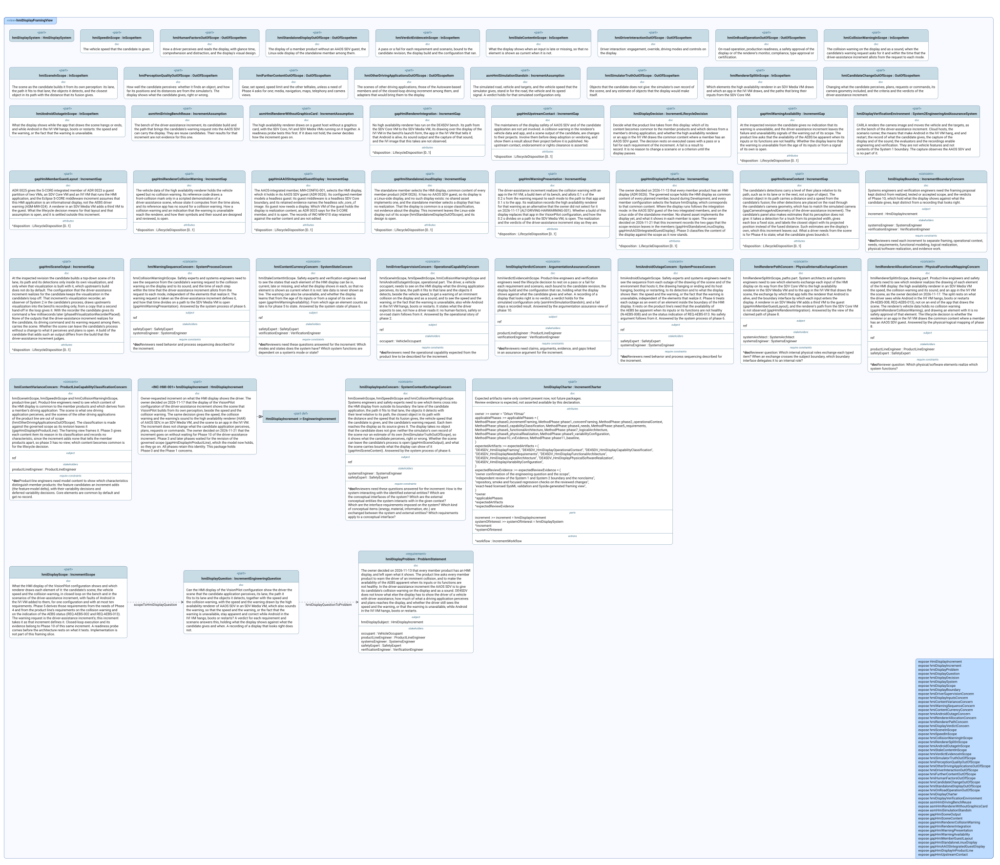

# Hmi Views

This index lists every SysML v2 `view` declared in the `.sysml` files of
this first-level model area. Each entry explains the reviewer question in
plain language and embeds the committed diagram SysIDE renders from the
view (`syside viz view`, run by the Privileged Syside Validation workflow).
The SVGs live in [`diagrams/`](diagrams/) beside the model files.

Generated by `scripts/generate_view_index.py` — do not edit by hand.

**1 file, 1 view, 1 published diagram.**

## `hmi_display_framing.sysml`

### `hmiDisplayFramingView`

Shows the model elements selected to address the hmi display boundary concern.

- **Source:** `hmi_display_framing.sysml`
- **Viewpoint:** `hmiDisplayFramingViewpoint` (`IncrementFramingViewpoint`)
- **Concern:** `hmiDisplayBoundary`
- **Exposes:** `HmiDisplayIncrement`, `hmiDisplayIncrement`, `hmiDisplayProblem`, `hmiDisplayQuestion`, `hmiDisplayDecision`, `hmiDisplaySystem`, `hmiDisplayScope`, `hmiDisplayBoundary`, `hmiDriverSupervisionConcern`, `hmiDisplayInputsConcern`, `hmiContentVarianceConcern`, `hmiWarningSequenceConcern`, `hmiContentCurrencyConcern`, `hmiAndroidOutageConcern`, `hmiRendererAllocationConcern`, `hmiRendererPathConcern`, `hmiDisplayVerdictConcern`, `hmiSceneInScope`, `hmiSpeedInScope`, `hmiCollisionWarningInScope`, `hmiRendererSplitInScope`, `hmiAndroidOutageInScope`, `hmiStaleContentInScope`, `hmiVerdictEvidenceInScope`, `hmiSimulatorTruthOutOfScope`, `hmiPerceptionQualityOutOfScope`, `hmiOtherDrivingApplicationsOutOfScope`, `hmiDriverInteractionOutOfScope`, `hmiFurtherContentOutOfScope`, `hmiHumanFactorsOutOfScope`, `hmiCandidateChangeOutOfScope`, `hmiStandaloneDisplayOutOfScope`, `hmiOnRoadOperationOutOfScope`, `hmiDisplayCharter`, `hmiDisplayVerificationEnvironment`, `asmHmiDrivingBenchReuse`, `asmHmiRendererWithoutGraphicsCard`, `asmHmiSimulationStandsIn`, `gapHmiSceneOutput`, `gapHmiSceneContent`, `gapHmiRendererCollisionWarning`, `gapHmiRendererIntegration`, `gapHmiWarningPresentation`, `gapHmiWarningAvailability`, `gapHmiMemberGuestLayout`, `gapHmiDisplayInProductLine`, `gapHmiUpstreamContact`
- **Render:** `asTreeDiagram`

- **Diagram status:** Published from the committed SysIDE SVG.
- **Presentation note:** This is a dense review artifact; open the SVG at full size rather than reading it from the page thumbnail.

