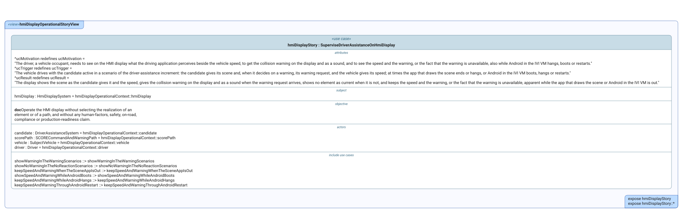

# Hmi Views

This index lists every SysML v2 `view` declared in the `.sysml` files of
this first-level model area. Each entry explains the reviewer question in
plain language and embeds the committed diagram SysIDE renders from the
view (`syside viz view`, run by the Privileged Syside Validation workflow).
The SVGs live in [`diagrams/`](diagrams/) beside the model files.

Generated by `scripts/generate_view_index.py` — do not edit by hand.

**3 files, 5 views, 3 published diagrams.**

## `hmi_display_framing.sysml`

### `hmiDisplayFramingView`

Shows the model elements selected to address the hmi display boundary concern.

- **Source:** `hmi_display_framing.sysml`
- **Viewpoint:** `hmiDisplayFramingViewpoint` (`IncrementFramingViewpoint`)
- **Concern:** `hmiDisplayBoundary`
- **Exposes:** `HmiDisplayIncrement`, `hmiDisplayIncrement`, `hmiDisplayProblem`, `hmiDisplayQuestion`, `hmiDisplayDecision`, `hmiDisplaySystem`, `hmiDisplayScope`, `hmiDisplayBoundary`, `hmiDriverSupervisionConcern`, `hmiDisplayInputsConcern`, `hmiContentVarianceConcern`, `hmiWarningSequenceConcern`, `hmiContentCurrencyConcern`, `hmiAndroidOutageConcern`, `hmiRendererAllocationConcern`, `hmiRendererPathConcern`, `hmiDisplayVerdictConcern`, `hmiSceneInScope`, `hmiSpeedInScope`, `hmiCollisionWarningInScope`, `hmiRendererSplitInScope`, `hmiAndroidOutageInScope`, `hmiStaleContentInScope`, `hmiVerdictEvidenceInScope`, `hmiSimulatorTruthOutOfScope`, `hmiPerceptionQualityOutOfScope`, `hmiOtherDrivingApplicationsOutOfScope`, `hmiDriverInteractionOutOfScope`, `hmiFurtherContentOutOfScope`, `hmiHumanFactorsOutOfScope`, `hmiCandidateChangeOutOfScope`, `hmiStandaloneDisplayOutOfScope`, `hmiOnRoadOperationOutOfScope`, `hmiDisplayCharter`, `hmiDisplayVerificationEnvironment`, `asmHmiDrivingBenchReuse`, `asmHmiRendererWithoutGraphicsCard`, `asmHmiSimulationStandsIn`, `gapHmiSceneOutput`, `gapHmiSceneContent`, `gapHmiRendererCollisionWarning`, `gapHmiRendererIntegration`, `gapHmiWarningPresentation`, `gapHmiWarningAvailability`, `gapHmiMemberGuestLayout`, `gapHmiStandaloneLinuxDisplay`, `gapHmiAAOSIntegratedGuestDisplay`, `gapHmiDisplayInProductLine`, `gapHmiUpstreamContact`
- **Render:** `asTreeDiagram`

- **Diagram status:** Published from the committed SysIDE SVG.
- **Presentation note:** This is a dense review artifact; open the SVG at full size rather than reading it from the page thumbnail.

## `hmi_display_needs_requirements.sysml`

### `hmiDisplayNeedsView`

Systems engineers and product-line engineers need the stakeholder needs of the HMI display with their statements and sources, and the planned stakeholder review of each, to judge whether the needs cover the concerns of phase 1.

- **Source:** `hmi_display_needs_requirements.sysml`
- **Viewpoint:** `selectedNeedsViewpoint` (`StakeholderRequirementDefinitionViewpoint`)
- **View type:** `TVD::TableView`
- **Concern:** `hmiDisplayNeedsConcern`
- **Exposes:** `needPerceivedSceneOnTheDisplay`, `needVehicleSpeedOnTheDisplay`, `needCollisionWarningOnRequest`, `needSpeedAndWarningThroughOutages`, `needNoElementShownAsCurrentWhenItIsNot`, `needRunsIdentifyTheDisplay`

- **Diagram status:** Not yet published in this folder.

_Diagram not present: `diagrams/diagram-table-hmiDisplayNeedsView.svg` (regenerate via the Privileged Syside Validation workflow)._

### `hmiDisplayNeedValidationView`

Systems engineers and product-line engineers need the stakeholder needs of the HMI display with their statements and sources, and the planned stakeholder review of each, to judge whether the needs cover the concerns of phase 1.

- **Source:** `hmi_display_needs_requirements.sysml`
- **Viewpoint:** `selectedNeedValidationViewpoint` (`StakeholderRequirementDefinitionViewpoint`)
- **View type:** `TVD::TableView`
- **Concern:** `hmiDisplayNeedsConcern`
- **Exposes:** `hmiSceneValidationPlan`, `hmiSpeedValidationPlan`, `hmiWarningValidationPlan`, `hmiOutageValidationPlan`, `hmiCurrencyValidationPlan`, `hmiDisplayIdentityValidationPlan`

- **Diagram status:** Not yet published in this folder.

_Diagram not present: `diagrams/diagram-table-hmiDisplayNeedValidationView.svg` (regenerate via the Privileged Syside Validation workflow)._

## `hmi_display_operational_context.sysml`

### `hmiDisplayOperationalContextView`

System architects, systems engineers and open-source reviewers need to see what is inside the HMI display and what is around it: the candidate application, the Eclipse S-CORE path, the vehicle and the driver, and which item crosses the boundary in which direction.

- **Source:** `hmi_display_operational_context.sysml`
- **Viewpoint:** `hmiDisplayContextViewpoint` (`OperationalContextDefinitionViewpoint`)
- **Concern:** `hmiDisplayContextConcern`
- **Exposes:** `hmiDisplayOperationalContext`, `hmiDisplayOperationalContext::*`, `hmiDisplayOperation`
- **Depth:** `2`
- **Render:** `asTreeDiagram`

- **Diagram status:** Published from the committed SysIDE SVG.

### `hmiDisplayOperationalStoryView`

Systems engineers, verification engineers and open-source reviewers need the HMI display told in stakeholder language: what the driver sees in the scenarios of the driver-assistance increment, with and without a warning, and while the app that draws the scene or Android in the IVI VM is out.

- **Source:** `hmi_display_operational_context.sysml`
- **Viewpoint:** `hmiDisplayStoryViewpoint` (`OperationalStoryViewpoint`)
- **Concern:** `hmiDisplayStoryConcern`
- **Exposes:** `hmiDisplayStory`, `hmiDisplayStory::*`
- **Depth:** `1`
- **Render:** `asTreeDiagram`

- **Diagram status:** Published from the committed SysIDE SVG.

